# A close-up per resistor, focused for its bands (2026-11-09)

**Question.** After segmentation, should each resistor get a capture of its own, at the focus that suits
where it lies, to read its bands from? One focus can't suit the whole plate: the front is sharpest near
322, the back near 290 to 304 (`../2026-11-09_front_back/` and part 2 here).

**Answer.**
- **Part 1** (grid experiment): focus sharpens the bands, but the reader in use reads *worse* as crops get sharper. It has only seen soft ones.
- **Part 2** (the method, built and tested): each cycle now takes one close-up per resistor, at a focus chosen from the resistor's distance to the lens. It works: front-of-plate resistors come out 1.4 to 1.9× sharper, and the whole cycle adds about 3.5 s per resistor. The readings didn't improve, as part 1 predicted, and one was **confidently wrong**. That was the reader, not the close-up (see part 2).

The next step is a reader trained on close-ups, with sharpness varied in training.

# Part 1: the grid experiment

## What was done

`focus_exposure_grid.py` found the plate, then took 15 captures: 5 focus settings (290, 298, 306, 314,
322) × 3 plate levels (grey about 185, 218, 231), each the mean of 8 frames. Each capture was segmented
again (focus changes the image scale slightly), each body cut into a band crop as `read_plate` does, its
sharpness measured (mean squared gradient of the crop) and read by the reader in use,
`runs/band_reader_final`. Focus was put back to 306 afterwards. Run twice, a few minutes apart: run 2
made the images and `grid.json`; run 1's results are in `run1.csv`.

Two bodies were on the plate, both near its front: a beige 1 kΩ (brown, black, red, gold, clear by eye)
and a blue body taken to be the 4.7 kΩ from 6 Nov (not re-measured). Both are parts the reader was
trained on. A third, turquoise, lay partly off the plate and wasn't segmented.

## Results

**1. Before and after: the camera's view at the config focus (306) and at 322.** The bands' edges are
crisper at 322; the reader reads the beige right at 306 and wrong at 322.

**2. The crops the reader is given, at every focus (plate at the reading level).**

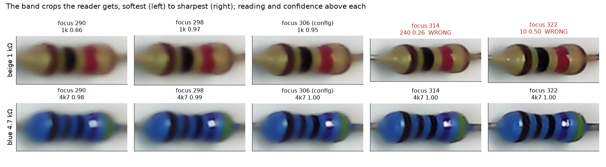

**3. Focus does what it should.** Both bodies get steadily sharper all the way to 322: 3.6× from 290
for the beige, 3.3× for the blue. Plate level barely matters, except the dimmest is a little softer.

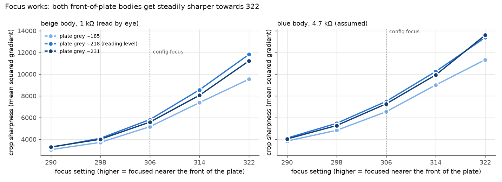

**4. The reader does not.** Its probability for the true value, beige: high at 298 to 306, falling
through 314 to 0.1 to 0.7 at 322. The blue reads 4.7 kΩ at 0.98 or more everywhere but one capture
(290, brightest: 1.8 kΩ at 0.67).

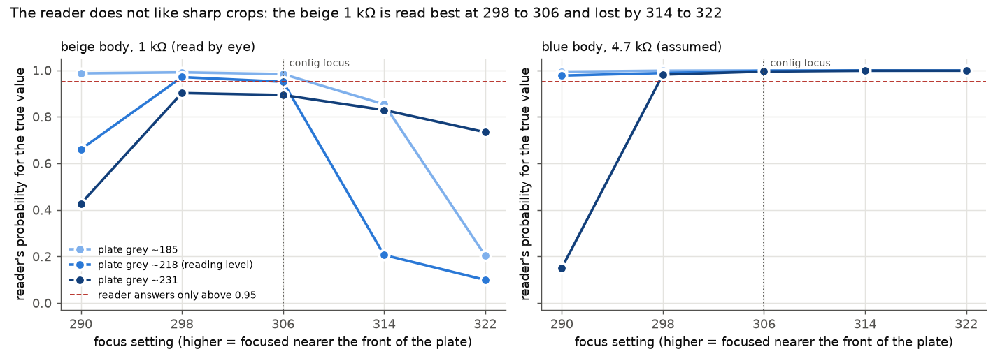

| Beige 1 kΩ, plate at reading level | 290 | 298 | 306 | 314 | 322 |
|---|---|---|---|---|---|
| Sharpness, run 2 | 3,256 | 4,093 | 5,819 | 8,558 | 11,824 |
| Reading, run 2 | 1k 0.66 | 1k 0.97 | 1k 0.95 | **240 Ω 0.26** | **10 Ω 0.50** |
| Reading, run 1 | 1k 0.92 | 1k 0.98 | 1k 0.88 | 1k 0.55 | **10 Ω 0.44** |

**5. Both runs together, against sharpness:** every wrong reading of the beige is above sharpness
8,500; every right one at or above the 0.95 limit is below 7,600.

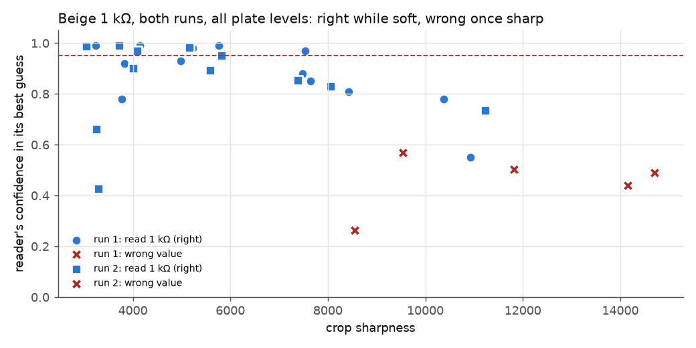

**6. What changes in the reader's mind (beige).** At 298 it sees brown, (black or gold), red, gold. At
322 it calls the red band black: brown, black, black, gold = 10 Ω. The red band is plainly red in the
sharp crop, so this is the reader, not the picture.

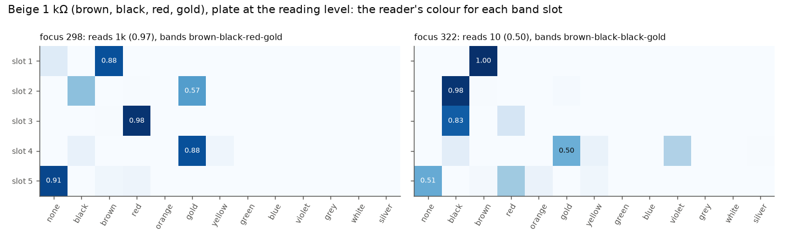

## Why

The reader has only seen soft crops. The synthetic crops are cut from frames rendered at 10 px/mm; the
real ones were all taken at focus 314, mostly away from each body's best; and `band_reader.augment`
varies light, tint and noise but never sharpness (its docstring says focus, but there is no blur). A crop
sharper than anything it trained on is new to it. Very soft crops (290) hurt too, a little: it does best
at the sharpness it knows.

## What it means

1. **Best-focus capture is still right, together with a reader trained for it:** re-collect the measured
   parts with it, and train with sharpness varied both ways (blur and sharpen), so focus can't move a
   reading. Then run this grid again: the beige line in figure 4 should be flat.
2. **The reader needs that robustness anyway:** the config focus just changed (314 → 306), and the
   plate's front and back differ by more than that.
3. Plate level, over 185 to 231, mattered much less than focus here.

**Limits:** two bodies, one plate, both seen in training, and the blue's value assumed. The trend is the
same in both runs and at all three levels, but it is one case. The run-to-run spread is large (beige at
290: 0.92 then 0.66), so single captures shouldn't be trusted to two decimals.

# Part 2: the method, a close-up per resistor

Code: `src/robot_offline/post/bands/closeup.py`, used by `tools/read_plate.py --closeups`. Tests:
`tests/post/test_closeup.py`. Figures 10 to 13 come from a real, timed cycle (session `2026-11-09_f`).

## Why: the plate is at a slant to the lens

The camera looks down at the plate from beyond its front edge. So the front of the plate is about 225 mm
from the lens and the back about 280 mm, and each needs a different focus. The config's 306 is sharpest
only along one line across the plate:

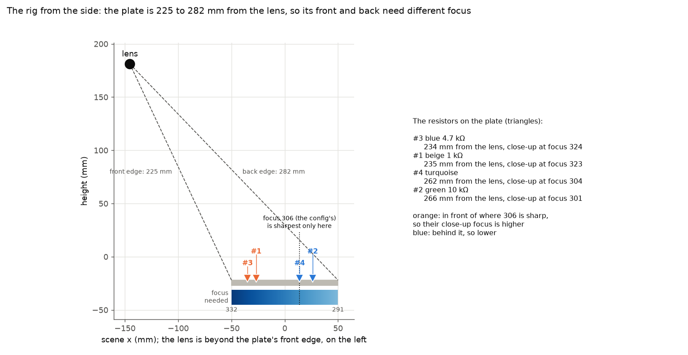

Seen from above, the focus each place needs runs in bands across the plate. A resistor's position from
segmentation says which band it lies in:

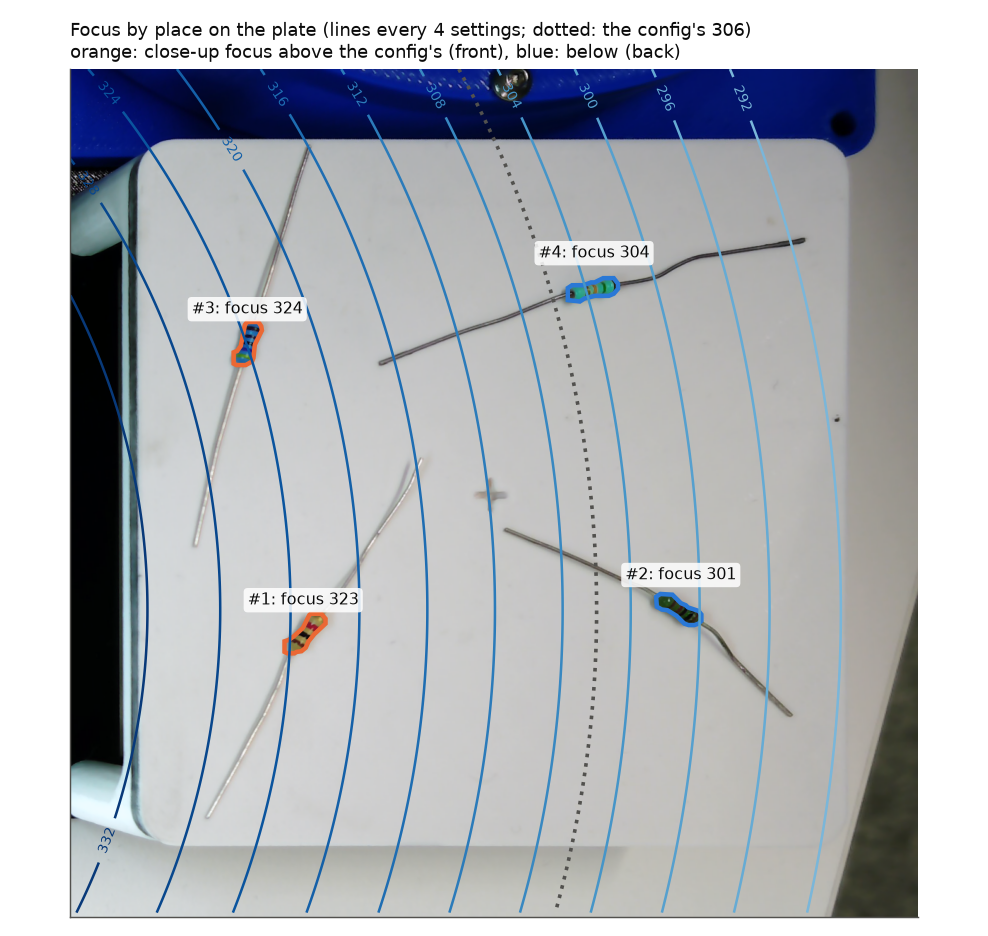

## How a cycle goes

1. **Find and segment, as before.** The plate is found and the exposure set for reading, with the plate at grey 205 to 225. Then 8 frames are averaged at the config focus (306) and segmented. Every resistor is read from this first capture, so nothing changes for a tool that stops here.
2. **Each resistor's distance from the lens.** The centre of its segmented outline is taken onto the plate's surface in mm, then measured to where the plate fit puts the lens (scene mm about (−145, −147, 182): beyond the plate's −x edge, 182 mm up). From that lens the plate runs front to back along x, about 230 to 280 mm away.
3. **Its focus, from that distance.** A lens's focus setting goes with the inverse of distance, so the model is `focus = a + b / distance`, fitted to measured `[distance, best focus]` points in `configs/camera.toml [closeup]`. With today's points it's `132 + 44,865 / distance`: 323 at the front of the plate (235 mm), 302 at the back (265 mm).
4. **One close-up per resistor.** For each one: set its focus, read 7 frames to let it settle (a focus change shows on the 5th or 6th frame read, measured today), then average 4. The resistors are taken in order of focus, so the lens moves one way only. The camera's focus goes back to 306 afterwards; the exposure isn't touched.
5. **Find it again in its close-up.** Changing focus scales the picture slightly, so segmentation is run again, only on the tiles round the resistor, and the outline nearest the first one, within 3 mm, is taken. If none is found, the first outline is used (`found_again: false`).
6. **Cut and read.** The band crop is cut from the close-up as before, with that capture's own white balance, and read.

Each resistor in `predictions.json` then has both readings, the first capture's and the close-up's (`closeup`, with each step's time). The crops go to `crops/` and `closeups/`, side by side in `closeups.jpg`.

The same steps for two resistors, one at the front of the plate and one at the back:

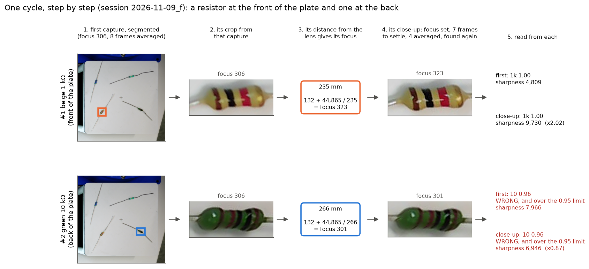

The front resistor's close-up is twice as sharp. The back one's isn't sharper, because its focus (301) is
next to the config's. That back resistor is the green 10 kΩ, read as 10 Ω at 0.96 in *both* captures:
confidently wrong, before any close-up was taken.

**Calibrating the focus model** (at rig setup, or when the focus drifts):
`python -m robot_offline.post.bands.closeup calibrate --save` sweeps focus from 278 to 346 over whatever resistors are on the plate. It finds each one's sharpest setting, between samples, and adds those points to the config. Use resistors both near the front and near the back, or it can't fit the slope. Today it took 2 min 15 s for 4 resistors.

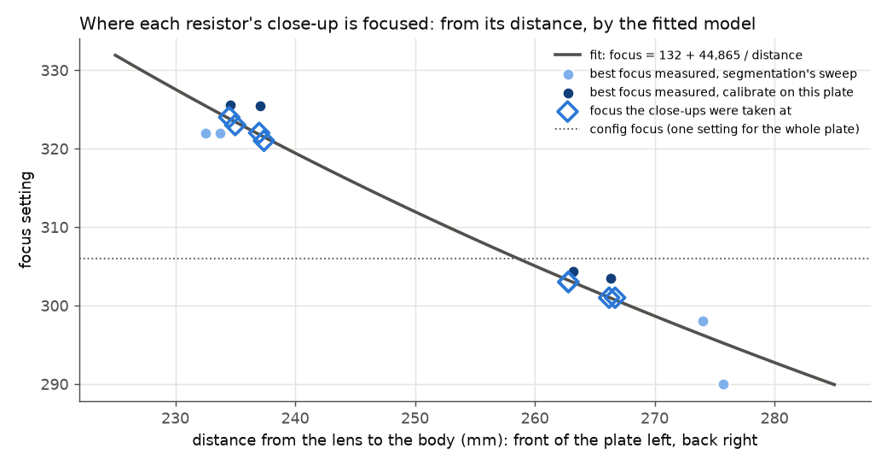

Figure 7: today's calibration (dark) found each resistor's best focus 3 to 6 settings higher than the segmentation session's sweep a few hours earlier (light), at both front and back. That's the focus drift that session reported. The fit sits between the two, so today's close-ups were 2 to 4 settings below their best. When the points disagree like this, `calibrate --save --fresh` keeps only the new ones.

## The test

Two cycles, a few minutes apart (sessions `2026-11-09_d` and `_e`), on four resistors:
- **Front of the plate, about 236 mm from the lens:** #2 beige 1 kΩ, #3 blue 4.7 kΩ (assumed).
- **Back of the plate, about 265 mm:** #1 green 10 kΩ (the user's only green part), #4 turquoise (value not confirmed).

The reader was `runs/band_reader_final`, which trained on all of them except, perhaps, the turquoise.

**Sharpness:** front-of-plate resistors gain 1.4 to 1.9×. Back ones are unchanged (0.94 to 1.00), because their close-up focus (301, 303) is next to the config's 306.

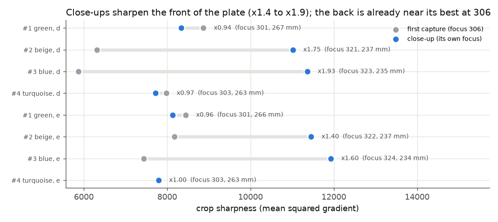

**The crops,** from one cycle:

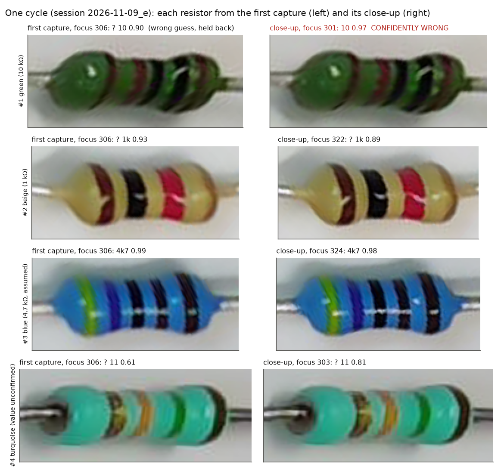

| Resistor | First capture, d / e | Close-up, d / e |
|---|---|---|
| #1 green 10 kΩ, back | ? 10 Ω 0.85 / ? 10 Ω 0.90 | ? 10 Ω 0.79 / **10 Ω 0.97 (confidently wrong)** |
| #2 beige 1 kΩ, front | 1k 0.96 / ? 1k 0.93 | ? 1k 0.93 / ? 1k 0.89 |
| #3 blue 4.7 kΩ, front | 4k7 0.99 / 4k7 0.99 | 4k7 1.00 / 4k7 0.98 |
| #4 turquoise, back | ? 11 Ω 0.69 / ? 11 Ω 0.61 | ? 11 Ω 0.44 / ? 11 Ω 0.81 |

Every resistor was found again in its close-up.

**The readings didn't improve**, as part 1 predicted: the beige read slightly worse sharpened, and the blue was right either way.

**The green 10 kΩ was read as 10 Ω at 0.97**, above the 0.95 limit, so the robot would have trusted it. That's the failure that must not happen. The close-up didn't cause it: that capture's focus (301) and sharpness were almost the first capture's (306). Every capture of this part in this test read 10 Ω (brown, black, black, gold, brown, where the true bands are brown, black, black, red, brown) at 0.79 to 0.97, and this one crossed the limit. So the reader's confidence isn't safe on its own, even on a part it trained on. That has to be fixed in the reader whether or not close-ups are used.

**Time,** measured on session `_f`: 13.2 s for the 4 close-ups, 3.2 to 3.5 s each.

| Step | Time |
|---|---|
| Focus set, 7 frames to settle | 1.05 to 1.25 s |
| 4 frames read and averaged | about 1.0 s |
| White balance | about 0.4 s |
| Found again | 0.6 to 0.8 s |
| Crop cut | under 0.05 s |

The frames come at about 5 a second at full resolution, so most of each close-up is waiting for the
camera. The first version took 5.6 s each, until averaging was changed from floating point (1.9 s) to
16-bit sums.

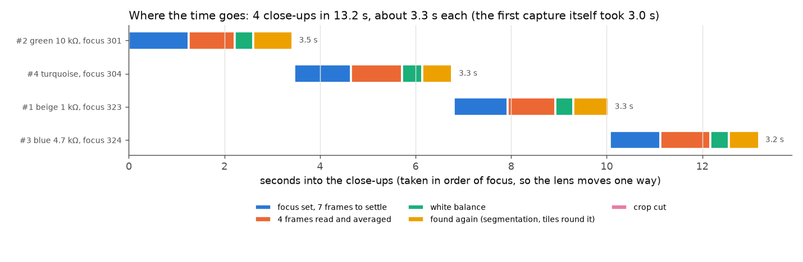

In that run the first pass was slow: 86 s to find the plate, and 18 s to segment, which includes loading
the model onto the GPU. Neither is typical, and neither is part of the close-ups.

## What part 2 means

1. **The capture side is done and works.** Positions from segmentation pick each resistor's focus, the lens gets there, the resistor is found again, and front-of-plate crops are clearly sharper.
2. **It helps the front of the plate only.** The config focus (306) already suits the back. A cycle could skip close-ups whose focus is within a few settings of 306 and save about 3.5 s for each one skipped.
3. **The reader is the bottleneck.** Next: retrain it on close-up crops of the measured parts, with sharpness varied both ways in training, then rerun part 1's grid and this test.
4. **Its confidence is not yet safe.** The green part shows that a high score can be wrong on a part it has seen. Any reader must be judged on held-out parts by its *confidently wrong* rate before the robot trusts it. Until then, every value should be measured electrically.
5. **Calibrate the focus model at setup** with `--fresh`, because the focus drifts during the day.

## Files

- `make_method_figures.py`: figures 10 to 13, how the method works, from session `2026-11-09_f` (re-segments its first capture for the outlines). `python experiments/2026-11-09_band_focus/make_method_figures.py experiments/2026-11-09_band_focus`
- `make_closeup_figures.py`: figures 7 to 9, from sessions `2026-11-09_d` and `_e` in `data/captures/` and the points in `configs/camera.toml`. `python experiments/2026-11-09_band_focus/make_closeup_figures.py experiments/2026-11-09_band_focus`
- `focus_exposure_grid.py`: the captures. `python experiments/2026-11-09_band_focus/focus_exposure_grid.py experiments/2026-11-09_band_focus` (needs the camera free; about a minute)
- `make_figures.py`: the figures, from the files below. `python experiments/2026-11-09_band_focus/make_figures.py experiments/2026-11-09_band_focus`
- `grid.json`: run 2, every body × capture: settings, plate level, sharpness, reading, slot log-probabilities
- `run1.csv`: run 1's readings and sharpness (its log-probabilities weren't kept)
- `crops/`, `raw/`: run 2's band crops and raw-frame close-ups, `body{0 blue, 1 beige}_plate{170,205,230}_focus{…}.png`; `crops.png`, a sheet of all crops; `overview.jpg`, the plate
- `figures/`: the six figures above
