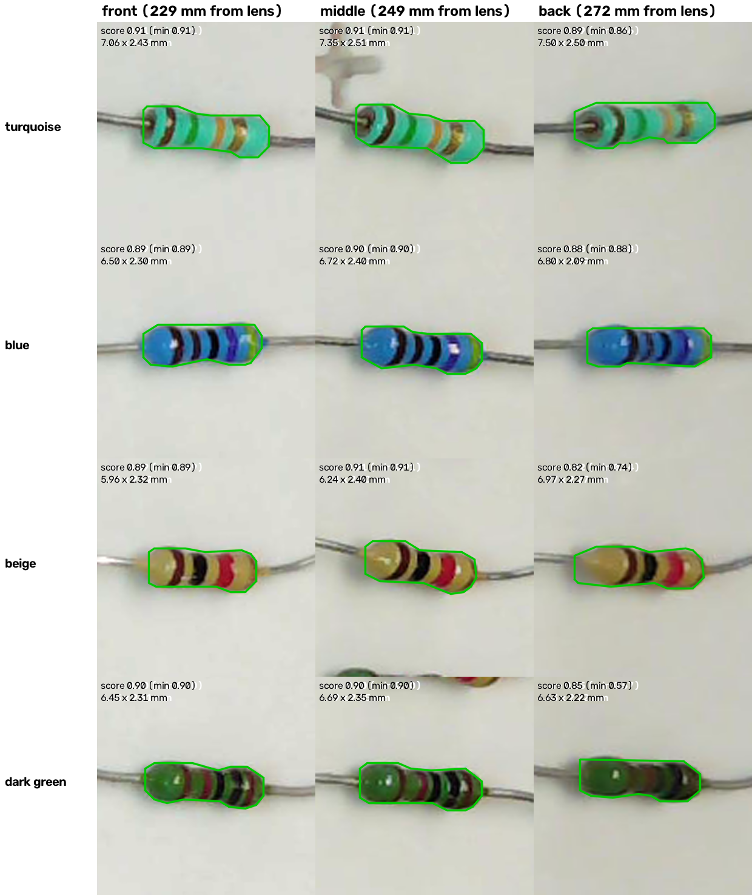
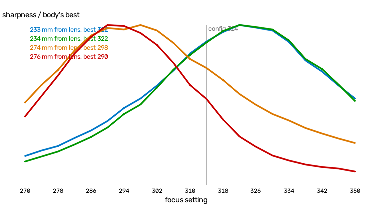
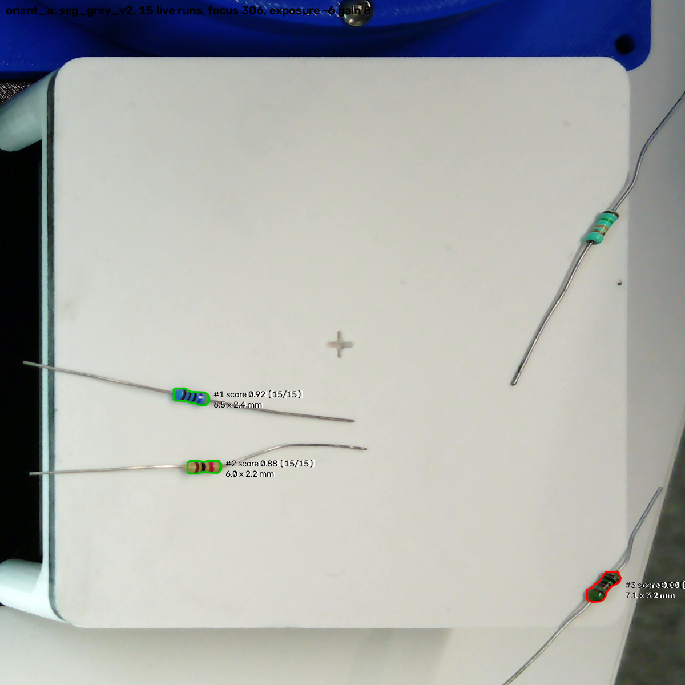
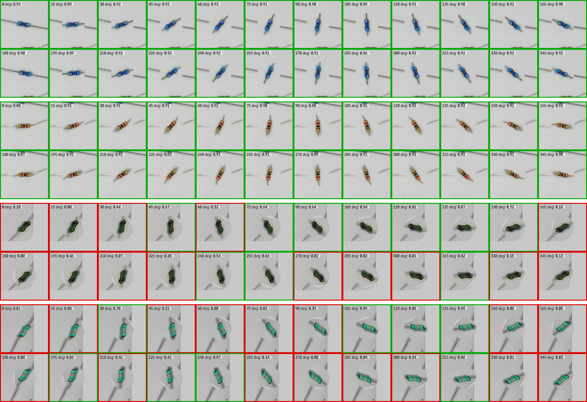

# Front vs back of the plate: segmentation test, 2026-11-09

**Question.** In `live_detect`, resistors at the back of the pick plate (furthest from the camera) seemed to
get lower confidence. Does segmentation change between the front and the back, and how?

**Answer, in short.** All four parts were found in every run at every position. At the back the model is
less sure and less steady:

- **Score:** median 0.86 against 0.90 to 0.91. The lowest single run was 0.57 at the back and 0.89 elsewhere.
- **Outline stability:** the centroid jitters about 2.5 times as much between runs (0.09 mm against 0.04 mm).
- **Size:** bodies come out about 0.5 mm longer than at the front.

The beige and dark green parts drop the most. At the back the plate is darker, and the camera sees it with
fewer pixels per mm and slightly out of focus.

Two follow-ups narrowed the cause:

- **Focus was not it.** The focus was set too near for the back (changed from 314 to 306), but
  segmentation scored the same at every focus.
- **Closeness to the edge is the big effect.** Within about 5 mm of the back edge, whether a body is
  found depends on its angle: two diagonal bodies there were missed in 15 of 15 and 13 of 15 runs. The
  synthetic training data almost never puts a body that close to the edge, and never lets a lead run off
  the plate. See "Follow-up: orientation, and the back edge".

## Setup

- **Rig and camera:** the pick plate, with the Arducam on the camera tower 200 mm above the plate and tilted
  36° from vertical (`configs/camera.toml`). Lab bench, room lighting.
- **Model and threshold:** `models/seg_grey_v2/best.pt`, run exactly as `live_detect` runs it. That means
  plate search and exposure control at the band-reading level (`learned.READING_LEVEL`, plate grey 205 to
  225), `rectify.model_input`, one 1024 px tile, greyscale input, and conf 0.05 (`steady.FLOOR`). Exposure
  settled at -6 with gain 8 for all three captures.
- **Parts:** four resistors, one of each colour: turquoise (metal film), blue (metal film), beige (carbon)
  and dark green. They lay side by side about 1 cm apart, leads pointing towards the camera tower (along
  the line of sight).
- **Positions:** the group was slid as a block, keeping its layout, to three positions:

| Position | Distance from lens | Note |
|---|---|---|
| front | 229–230 mm | nearest the camera; the front edge is at 226 mm |
| middle | 248–250 mm | |
| back | 271–274 mm | the back edge is at 276 mm |

- **Repeats:** at each position, 15 runs of the model on consecutive live frames, about 0.3 s apart.

## Measures, per part and position

- **Score:** the median, the minimum, and the number of runs at 0.5 or more (live_detect's default
  threshold).
- **Length and width:** from the outline's minimum-area rectangle, in mm (the top-down image is
  10 px/mm). The same part should measure the same at every position, so a change is a change in the
  outline.
- **Centre jitter:** the RMS of the outline's centroid about its mean over the 15 runs, in mm.
- **Yaw SD:** the standard deviation of the outline's angle over the runs, in degrees.
- **Run-to-run IoU:** the median overlap of consecutive outlines.
- **Local plate grey:** the plate 2 to 6 mm round the body, in the model's input (plate brought to 200
  overall).
- **Edge sharpness:** the 90th percentile gradient on the outline divided by the body's contrast (1/px;
  higher is sharper).
- **Expected extra length:** how far a 2.4 mm body's top is pushed along the line of sight by the camera's
  angle (2.4 × ground distance / 200 mm). It is the part of the length change that geometry alone predicts.

## Results

### Mean over the four parts

| Position | Score median | Lowest single run | Centre jitter (mm) | Run-to-run IoU | Length (mm) | Width (mm) | Local plate grey |
|---|---|---|---|---|---|---|---|
| front | 0.90 | 0.89 | 0.036 | 0.969 | 6.49 | 2.34 | 204 |
| middle | 0.91 | 0.90 | 0.033 | 0.969 | 6.75 | 2.41 | 199 |
| back | 0.86 | 0.57 | 0.091 | 0.953 | 6.97 | 2.27 | 188 |

### Per part

| Part | Position | Score median | Score min | Found ≥ 0.5 | Length (mm) | Width (mm) | Centre jitter (mm) | Run-to-run IoU | Local plate grey | Edge sharpness | Expected extra length (mm) |
|---|---|---|---|---|---|---|---|---|---|---|---|
| turquoise | front | 0.91 | 0.91 | 15/15 | 7.06 | 2.43 | 0.014 | 0.977 | 201 | 0.392 | 1.35 |
| turquoise | middle | 0.91 | 0.91 | 15/15 | 7.35 | 2.51 | 0.030 | 0.962 | 198 | 0.393 | 1.80 |
| turquoise | back | 0.89 | 0.86 | 15/15 | 7.50 | 2.50 | 0.092 | 0.950 | 188 | 0.353 | 2.21 |
| blue | front | 0.89 | 0.89 | 15/15 | 6.50 | 2.30 | 0.025 | 0.978 | 203 | 0.345 | 1.35 |
| blue | middle | 0.90 | 0.90 | 15/15 | 6.72 | 2.40 | 0.031 | 0.971 | 199 | 0.372 | 1.79 |
| blue | back | 0.88 | 0.88 | 15/15 | 6.80 | 2.09 | 0.053 | 0.978 | 188 | 0.337 | 2.20 |
| beige | front | 0.89 | 0.89 | 15/15 | 5.96 | 2.32 | 0.049 | 0.968 | 205 | 0.445 | 1.34 |
| beige | middle | 0.91 | 0.91 | 15/15 | 6.24 | 2.40 | 0.039 | 0.964 | 199 | 0.483 | 1.78 |
| beige | back | 0.82 | 0.74 | 15/15 | 6.97 | 2.27 | 0.135 | 0.936 | 187 | 0.425 | 2.22 |
| dark green | front | 0.90 | 0.90 | 15/15 | 6.45 | 2.31 | 0.055 | 0.954 | 205 | 0.335 | 1.36 |
| dark green | middle | 0.90 | 0.90 | 15/15 | 6.69 | 2.35 | 0.032 | 0.977 | 200 | 0.383 | 1.77 |
| dark green | back | 0.85 | 0.57 | 15/15 | 6.63 | 2.22 | 0.085 | 0.947 | 187 | 0.333 | 2.25 |

`results.md` has the same tables with yaw SD as well, generated by `summarise.py`.

## Findings

1. **Detection holds, confidence drops at the back.** Every part was found at 0.5 or more in all 45 of
   its runs. From front to back, the median score fell for every part: turquoise by 0.02, blue by 0.01,
   beige by 0.07 and dark green by 0.05. Single runs at the back went as low as 0.74 (beige) and 0.57
   (dark green). No run elsewhere scored below 0.89. So the drop seen in live_detect is real, and it is
   largest for the low-contrast parts. Under dimmer light the same margin is what lets a body fall below
   0.5: on 9 Nov, at another exposure, the dark green part scored 0.18 to 0.78.
2. **Outlines are less steady at the back.** Centre jitter rose about 2.5 times (mean 0.036 to 0.091 mm)
   and run-to-run IoU fell (0.969 to 0.953). That is still an order of magnitude inside the 1 mm centre
   target (`docs/plan.md`).
3. **Outlines grow longer towards the back.** Mean length rose 0.48 mm (6.49 to 6.97 mm). The direction
   matches the camera geometry: a body stands off the plate, so its top is seen pushed away from the
   camera, more so at the back. Geometry predicts about +0.9 mm. Beige grew +1.0 mm; the other three grew
   only +0.2 to +0.4 mm. Width was narrower at the back (2.34 to 2.27 mm, blue 2.09 mm).
4. **The back of the plate looks different to the model.** Three things stack up there:
   - **Darker:** the plate round the body is grey 188 in the model's input, against 204 at the front,
     about 8% darker. White balance brings the plate as a whole to 200, so the front ends up above that
     and the back below.
   - **Fewer pixels:** the camera gives about 8 px/mm at the back corner and 13 px/mm at the front, so
     rectification enlarges the back.
   - **Softer:** edge sharpness at the back is the lowest of the three positions for every part, and the
     back crops in the figure are visibly softer.

   The synthetic training data models all three effects, but on synthetic validation frames the score
   doesn't fall with distance at all: a median of 0.92 in every distance quartile, 627 bodies. So the
   synthetic back of the plate is easier than the real one.

## Follow-up: is it the focus?

The back resistors' bands looked soft in the camera image, so the focus was swept. The parts were left in
one scene: blue and beige at the front (233 to 234 mm from the lens), dark green and turquoise at the back
(274 to 276 mm).

**Focus sweep** (`focus_sweep.py`): focus 270 to 350 in steps of 4, measuring each body's sharpness in the
raw frame. Sharpness is the mean squared gradient inside its outline, relative to that body's own best.

| Body | Distance from lens | Sharpest at focus | Sharpness at 314 (config) | Sharpness at 306 |
|---|---|---|---|---|
| blue | 233 mm | 322 | 0.90 | 0.71 |
| beige | 234 mm | 322 | 0.89 | 0.72 |
| dark green | 274 mm | 298 | 0.73 | 0.89 |
| turquoise | 276 mm | 290 | 0.53 | 0.76 |

The configured focus, 314, favours the front of the plate. The back bodies are at 53 to 73% of their best
there. 306 is now the best worst case: every body is at 71% or more of its best. The bands at the back are
visibly better resolved at their own best focus (`focus_sweep_crops.png`, `focus_sweep.png`).

**Segmentation at three focus settings, same scene** (`focus314`, `focus306`, `focus294`, 15 live runs
each):

| Focus | Front blue | Front beige | Back green (lowest run) | Back turquoise (lowest run) | Back edge sharpness |
|---|---|---|---|---|---|
| 314 | 0.92 | 0.89 | 0.88 (0.81) | 0.89 (0.87) | 0.348 / 0.362 |
| 306 | 0.92 | 0.89 | 0.88 (0.76) | 0.89 (0.87) | 0.372 / 0.405 |
| 294 | 0.92 | 0.87 | 0.88 (0.66) | 0.89 (0.87) | 0.359 / 0.384 |

**Finding: the focus is set too near for the back of the plate, but that is not why segmentation scores
lower there.** Bringing the back into its best focus left the back scores unchanged at 0.88 and 0.89. The
dark green's occasional low run happened at every focus. The model works on a 10 px/mm greyscale image
and doesn't need band detail. What stays the same at every focus is that the back of the plate is darker
in the model's input: plate grey 186 at the back against 203 at the front.

The focus does matter for **reading the bands**, which needs that detail.

### Decision: focus 314 → 306 (`configs/camera.toml`, 2026-11-09)

The configured focus was changed from 314 to 306, for three reasons:

1. **The whole plate is in usable focus.** At 314 the back of the plate was at 53 to 73% of its best
   sharpness. At 306 every body, front and back, is at 71% or more (sweep above). The front loses little:
   from 90% to 71 to 72%.
2. **The bands at the back are resolved.** Reading the bands needs that detail. Segmentation doesn't, and
   its scores were the same at 314, 306 and 294, so the change costs segmentation nothing.
3. **The camera is brought back to what the synthetic training data assumes.** The sweep gives focus
   distance against setting: 322 is sharpest about 233 mm from the lens and 294 about 275 mm, roughly
   1.5 mm per step. So 314 now focuses about 245 mm out, at the plate centre (247 mm), and 306 about
   257 mm out. The synthetic camera focuses 15 mm beyond the centre (`[synthetic] focus_shift_mm` in
   `configs/dataset.toml`), matched to frames from 2026-10-23, when 314 did focus beyond the centre. 306
   restores roughly that, so the synthetic setting stays.

**The focus drifts.** On 2026-10-23 the far half of the plate was sharpest at 306 and the near half at
326, which gave 314. Today the back is sharpest at 290 to 298. This lens focuses with a voice-coil
motor and has no position feedback, so a given setting doesn't stay at one distance: it can shift with
temperature and with how the camera is mounted. Re-run `focus_sweep.py` whenever the rig is set up, and
set `focus` to its best worst case.

The robot repo (EE52043) opens the camera with this same `configs/camera.toml`, so the change applies
there too.

## Follow-up: orientation, and the back edge

**What was seen.** With the focus at 306, the user laid two parts across the front of the plate and two
diagonally near the back edge (`orient_a`, 15 live runs):

| Body | Position | Body to back edge | Median score | Found ≥ 0.5 |
|---|---|---|---|---|
| blue | front (-26, -140) mm | 76 mm | 0.92 | 15/15 |
| beige | front (-24, -152) mm | 74 mm | 0.88 | 15/15 |
| dark green | back corner (+46, -173) mm | 4 to 5 mm | 0.00 | 2/15 |
| turquoise | back (+45, -109) mm | 4 to 5 mm | not found | 0/15 |

The turquoise is missing from the overlay because no run found it. Both back bodies lie diagonally, and
each has a lead running off the plate.

**Orientation probe** (`orientation_probe.py`). It keeps each body exactly where it is and turns only a
disc 6 mm in radius round it (the body and the start of its leads), from 0 to 345° in 15° steps,
scoring each angle. Position, light, focus and the body's own pixels stay the same; only its direction
changes. It was run on every capture:

| Capture | Body to back edge | Bodies | Score range over 24 angles | Angles under 0.5, per body |
|---|---|---|---|---|
| `front_a` | about 83 mm | 4 | 0.88 to 0.94 | 0, 0, 0, 0 |
| `mid_a` | about 47 mm | 4 | 0.85 to 0.94 | 0, 0, 0, 0 |
| `back_a` | 9 to 12 mm | 4 | 0.31 to 0.93 | 0, 1, 2, 0 |
| `orient_a`, front parts | 74 to 76 mm | 2 | 0.83 to 0.93 | 0, 0 |
| `orient_a`, back parts | **4 to 5 mm** | 2 | **0.00 to 0.89** | **14, 16** |

**Finding: orientation decides detection only near the back edge.** Away from it, a body is found at
every angle. Within about 5 mm of the edge, the score swings from 0 to 0.9 between 15° steps, with no
smooth pattern. The model has no reliable rule there and is guessing.

**Why: the training data almost never has a body there.** In the synthetic training set (`synth_v2`,
4,924 bodies), every resistor, leads included, lies wholly inside the plate (`synth.py`):

- only 79 bodies (1.6%) come within 5 mm of the back edge
- of those, 62 lie nearly parallel to it, 17 diagonally, and none pointing at it
- no body anywhere has a lead running off the plate

On the rig, parts dropped near the edge often lie diagonally with a lead over the edge, exactly the case
that is missing. Training augmentation rotates and flips frames, so this applies to any edge, not just the
back. The back is where it showed up in this test.

**What this means for the earlier results.** Some of the lower confidence at the back in the first
test (`back_a`, bodies 9 to 12 mm from the edge) is the start of this effect: two of its bodies had
angles under 0.5, while no front or middle body did. This morning's dry run, outside this folder,
missed a blue body 4 mm from the back edge entirely.

**The fix, for the next training run.** Let synthetic bodies lie right up to the plate edge at any angle,
with leads allowed to run off the plate (clipped by the plate mask as on the rig). The label rule is
unchanged: the body only, leads excluded. This is part of the next model's design:
`experiments/2026-11-09_object_seg_design/README.md`.

**Limits of the probe.** Turning a disc cuts the leads at its rim and leaves a faint seam (visible in
the crop sheets), so the turned images aren't fully natural. Two things make it a fair comparison anyway:
the front and middle bodies got exactly the same treatment and stayed at 0.83 or more at every angle, and
the back bodies in `orient_a` already failed as they lay (0.01 and 0.10), with no editing. A physical
version, one part turned in steps at one spot near the edge, would confirm the angle-by-angle pattern.

## Limits

- **One placement per position, one lighting, one orientation.** The leads pointed along the line of
  sight. A body lying across the line of sight may behave differently.
- **The 15 runs are of one scene,** so they show run-to-run noise, not the spread over placements.
- **Positions can't be fully separated from small changes in pose and lead bend** when the group was
  slid.
- **No hand labels:** outline quality is judged by consistency of the same part across positions and
  runs, not against a ground truth.

## Files

- **`record.py`:** records one placement.
  `python experiments/2026-11-09_front_back/record.py experiments/2026-11-09_front_back <tag> --runs 15`
- **`summarise.py`:** builds `results.md` and `figure_parts.png`, and redraws the overlays.
- **`focus_sweep.py`:** the focus sweep. It writes `focus_sweep.json`, `focus_sweep.png` and
  `focus_sweep_crops.png` (each body at the config focus, at the best worst case and at its own best).
  `record.py --focus N` overrides the focus for one capture (`focus314`, `focus306`, `focus294`).
- **`orientation_probe.py`:** turns each body in place and scores it.
  `python experiments/2026-11-09_front_back/orientation_probe.py experiments/2026-11-09_front_back <tag> [x,y ...]`.
  The extra `x,y` are body centres in rectified px that the live runs never found (the turquoise in
  `orient_a`: `1053,387`). Per capture it writes:
  - `<tag>_orientation.json`: every angle's score
  - `<tag>_orientation.png`: score against direction
  - `<tag>_orientation_crops.png`: every turned version, with its score
- **`orient_a`:** the capture of the user's orientation layout, with the same files as the other captures.
- **Per capture (`front_a`, `mid_a`, `back_a`):**
  - `<tag>.json`: per-body measures and every run's score
  - `<tag>_raw.png`: the last run's full 4608 × 2592 camera frame (Git LFS)
  - `<tag>_rectify.json`: its plate fit
  - `<tag>_rect.png`: the top-down image
  - `<tag>_model.png`: exactly what the model saw
  - `<tag>_overlay.png`: outlines, scores and sizes
