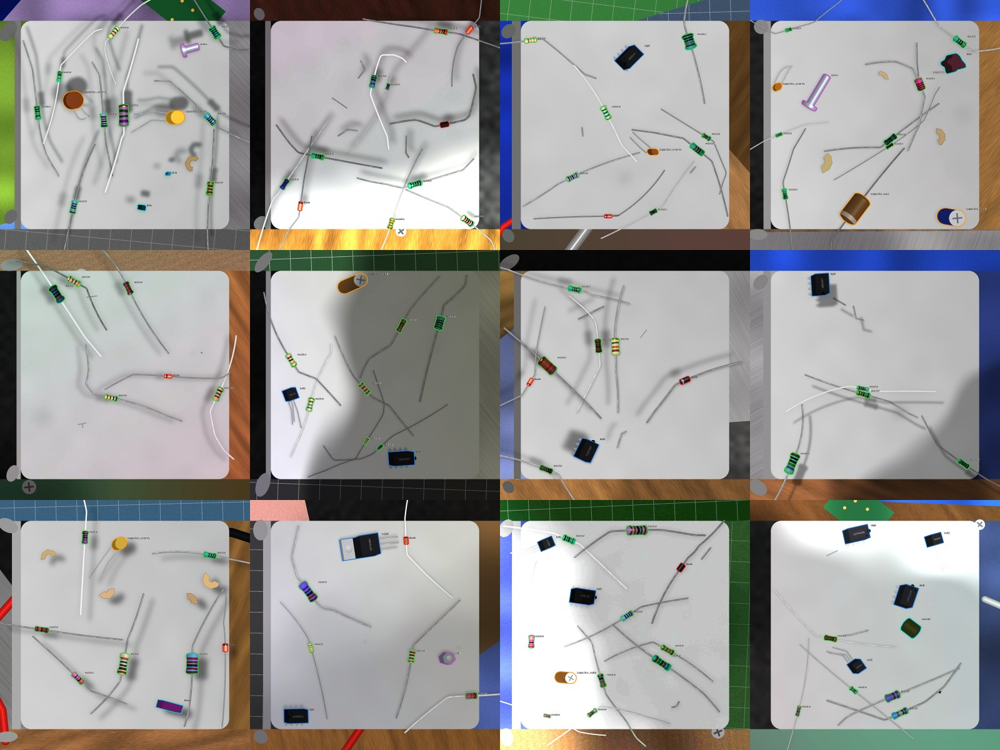
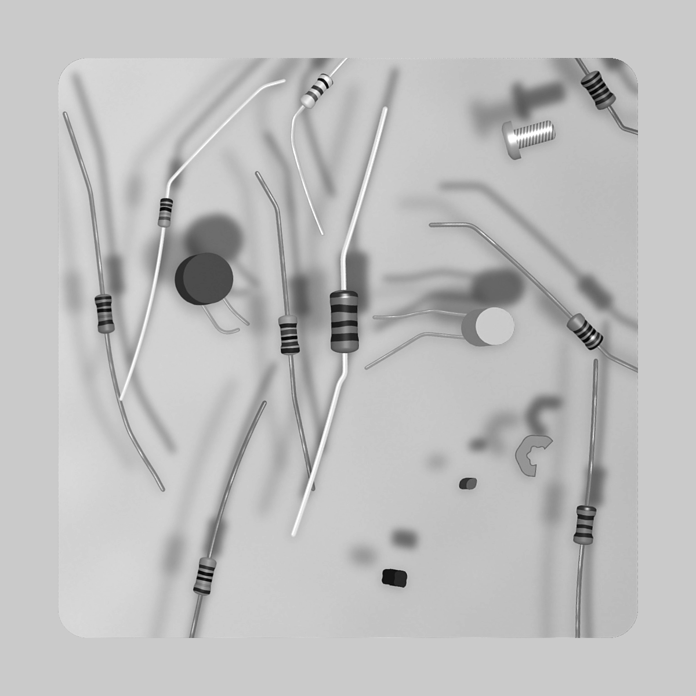
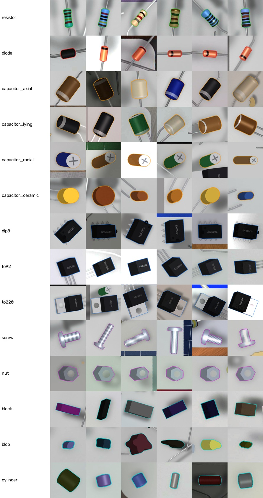

# Next segmentation model: what it learns, and why (design record, 2026-11-09)

**Status:** the synthetic data generator is built, and samples are below. Not yet trained. This records what the next model is meant to learn that
`seg_grey_v2` did not, the evidence behind each change, and how the result will be judged. When it is
trained, its results go in a new experiment folder and are compared against the tests below.
Working name: `seg_objects_v1`.

## In one paragraph

`seg_grey_v2` learned to find **resistor bodies** and nothing else. It was deliberately trained to ignore
everything that wasn't a resistor: op-amps, transistors and screws were drawn into its training frames
and labelled as background. Every resistor it saw lay wholly on the plate, leads included.

The next model learns to find **every object on the plate of a pickable size**, resistors among them,
with each object's body outlined. It sees objects right up to the plate edge, at any angle, with leads
running off the plate. Whether an object is a resistor is decided after segmentation, by a separate
classifier on a colour crop of it. Each object gets a centroid and a yaw from its outline.

## What changes

| | `seg_grey_v2` (now) | `seg_objects_v1` (next) | Why |
|---|---|---|---|
| **What it finds** | resistor bodies only | any object of a pickable size: resistors, diodes, capacitors, op-amps, screws, and other things | The robot should know about every object on the plate, and decide itself what to do with each |
| **Class** | `resistor_body` | one class, `object` | "Is it a resistor?" is decided after segmentation (below), so segmentation stays about shape |
| **Positive examples** | resistors only: waisted, banded bodies, 3.2 to 11 mm long, any paint | resistors, plus diodes (glass, black-bodied), capacitors (axial, radial, ceramic disc), op-amps (DIP-8), screws, and made-up shapes (blocks, cylinders, blobs in any colour and size in range) | The made-up shapes teach "an object" rather than a list of item types, so items outside the list are still found |
| **Negative examples (background)** | lead offcuts, crumbs, pencil marks, smudges, wood shavings, **and screws, TO-92, TO-220, DIP-8** | lead offcuts, crumbs, pencil marks, smudges (shavings: to decide) | The old model was taught to suppress the very parts now wanted |
| **Outline rule** (`docs/labelling.md`) | resistor body, leads excluded (rules v1) | body of any object; leads and pins excluded; a screw outlined whole (rules v2) | Same rule for resistors, so their labels and pick points don't change |
| **Near the plate edge** | every resistor, leads included, lies wholly on the plate. With 24 to 38 mm leads, a body can get near an edge only lying parallel to it. In `synth_v2`, 1.6% of bodies came within 5 mm of the back edge, none pointing at it, and no lead ever ran off the plate | leads may run off the plate, cut by the plate mask as on the rig. About a quarter of objects are placed 0.5 to 8 mm from an edge, at any angle, on all four sides and corners | On the rig, bodies within 5 mm of the back edge lying diagonally were missed: found in 0 of 15 and 2 of 15 live runs, and under 0.5 at 14 and 16 of 24 angles. Front and middle bodies were found at all 24 angles |
| **Back of the plate darker** | a random brightness ramp up to 14%, in a random direction | part of the ramp tied to the camera's direction: the back about 8% darker, as measured | On the rig the plate is grey 188 at the back and 204 at the front in the model's input. Confidence was lowest at the back |
| **Output per object** | outline, score, and for resistors a spine, centroid and yaw | outline, score, centroid, yaw, **elongation** (how meaningful the yaw is), and a resistor tag from the classifier | A round object (a capacitor can, a nut) has no meaningful yaw, and a square chip's yaw has a 90° ambiguity, so whatever uses the yaw needs to know how far to trust it |

### What stays the same

- **Input:** the rectified, plate-masked top-down image at 10 px/mm, in greyscale. Colour input was tried
  and scored worse (`seg_colour_v2`: 87 of 98 new parts, 4 false detections).
- **Camera simulation:** perspective warp to the raw view, focus blur that grows with distance, the
  sensor, sharpening, MJPG compression and rectification back. Also shadows, shade, tint and exposure.
- **Model and inference:** YOLOv8m-seg, started from COCO weights, one 1024 px tile per frame, the same
  live pipeline.

## Resistor or not: decided after segmentation

The resistor tag comes from a **separate classifier on the colour crop** of each object, cut from the
full-resolution camera frame as the band reader's crops are. It answers resistor, not a resistor, or
unsure.

It isn't part of segmentation because the segmentation model sees greyscale at 10 px/mm. What tells a
resistor from a diode or an inductor is colour and fine detail: a diode's single cathode band, a glass
body, the print on a capacitor. The crop has those; the segmentation input doesn't. A crop also needs
only a one-word label, not a drawn outline, so real training data is cheap.

**Limit:** some inductors look like resistors (a green body with colour bands). Vision catches most
non-resistors; the robot's electrical check stays the final word.

**Fallback:** if the classifier is weak, a two-class segmentation model (resistor, other object) is to
be tested against it.

## Known limits carried into the new model

**The visible outline is pushed away from the camera.** The camera sees an object's camera-facing side
as well as its top. For a resistor (2.4 mm high) that's up to about 1 mm, and it's what lengthened the
outlines towards the back in `2026-11-09_front_back`. For a 4 mm-high op-amp at the back of the plate
it's up to about 3.7 mm. The centroid isn't corrected for it yet. Correcting it needs a height estimate
per object, and is left for later.

## Deferred: which of two crossing leads is on top

This will be a post-processing step with OpenCV, not part of the model. It finds lead centrelines,
finds where two leads cross, and decides which is on top from which wire's edges run unbroken through
the crossing. It is planned for once segmentation is performing well enough.

The only part done now is that the synthetic generator **records each lead's path and which lead is
drawn on top**. That gives exact test cases for the post-process later and costs nothing to label. The
model does not learn from it.

## How the new model will be judged

Each test compares against `seg_grey_v2` under the same conditions.

| # | Test | Pass |
|---|---|---|
| 1 | Existing real test set (`test_sessions`, never trained on), resistors only, conf 0.5 | at least as good as `seg_grey_v2`: 93 of 98 new parts, 138 of 143 turquoise, 1 false detection |
| 2 | Near the plate edge: the orientation probe (`2026-11-09_front_back/orientation_probe.py`) on bodies within 5 mm of the edge, plus live captures of parts laid diagonally at the edge | under 0.5 at 0 of 24 angles, as front bodies are now (`seg_grey_v2`: 14 and 16 of 24); found in at least 14 of 15 live runs |
| 3 | Front, middle and back (re-run of `2026-11-09_front_back`, same four parts) | median score at the back within 0.02 of the front (`seg_grey_v2`: 0.86 against 0.90) |
| 4 | New real test session of non-resistor objects (diodes, capacitors, op-amps, screws and others on the rig, outlined by hand, never trained on) | number found, per kind; no detections on offcuts, crumbs or marks |
| 5 | Outline stability, live, 15 runs | centre jitter no worse than now: 0.04 mm front, 0.09 mm back |
| 6 | Resistor tag (the classifier, on held-out real crops) | share of resistors and of non-resistors tagged correctly; "unsure" counted separately |

## The synthetic set: how it is made (implemented 2026-11-09)

`python -m robot_offline.training.synth --profile objects --name <set>` draws the new set. The profile
is `[synthetic_objects]` in `configs/dataset.toml`, applied over `[synthetic]`. Without `--profile`,
`synth` draws exactly what it did before, so existing sets and band reading are unaffected. Tests are in
`tests/training/test_synth.py`, under "The objects profile".

| Setting | Value | What it does |
|---|---|---|
| `labelled_objects_per_frame` | 1 to 5 | non-resistor objects per frame, besides the 4 to 9 resistors (as before) |
| `object_size_mm` | 2 to 25 mm | longest side of made-up shapes and plain cylinders |
| `edge_fraction` | 0.25 | chance any body or object is placed against a plate edge (or two, at a corner), at any angle |
| `edge_gap_mm` | 0.5 to 8 mm | how close: its nearest point to the edge |
| `leads_off_plate` | 0.2 | chance a body's leads may run off the plate; one placed against an edge always may. The body itself must lie on the plate, rounded corners included. A first version allowed it for every body, and 72% of bodies then had a lead off the plate, far more than on the rig |
| `back_dark` | 0 to 12% | light falls off away from the camera, over everything drawn |

**The object kinds and how often each is drawn** (`synth.OBJECT_KINDS`). All are labelled with their
kind; the outline is the body only (leads and pins excluded), and a screw or nut is outlined whole.

| Kind | Share | Drawn as |
|---|---|---|
| `diode` | 18% | glass (DO-35: orange-red, black band, 3.4 to 4.6 mm) or moulded (DO-41: black, grey band, 4.2 to 5.4 mm), one lead out of each end |
| `capacitor_axial` | 6% | sleeved cylinder 4 to 10 mm across, a polarity ring, a lead out of each end |
| `capacitor_lying` | 4% | a radial can lying on its side, both leads out of one end, an aluminium end ring |
| `capacitor_radial` | 8% | a can standing on its legs, 4 to 10 mm across and 5 to 12 mm tall: aluminium top with a vent cross, sleeve side towards the camera |
| `capacitor_ceramic` | 8% | a disc 3 to 10 mm across lying flat, two legs out of one side |
| `dip8` | 10% | op-amp package with legs, pin-1 marks and faint part numbers (the drawing that was background before) |
| `to92`, `to220` | 5% each | transistor packages with legs (as before, now labelled) |
| `screw` | 10% | pan-head screw on its side, M2 to M4 size |
| `nut` | 4% | hexagon with a through hole, 4 to 8 mm across |
| `block` | 8% | made-up box, any colour, 2 to 25 mm |
| `blob` | 7% | made-up lumpy shape, any colour, 2 to 25 mm, not convex |
| `cylinder` | 7% | made-up rod without leads (a dowel, pin or standoff), any colour |

Every object stands up from the plate as a solid with a height. The camera sees its top pushed away
from the camera and its camera-facing side, as on the rig, and the label is that whole visible outline.

**Still background, never labelled:** lead offcuts, crumbs, pencil marks, smudges and wood shavings.

**Recorded per instance in the manifest** (objects profile only):
- `kind`
- for resistors, `bands` and `first_end` as before; `bands: []` for everything else (agreed with band
  reading, whose crop code skips non-resistors)
- `leads`: each lead's path, simplified to within 0.5 px
- `z`: drawing order, later on top, for the deferred crossing check

## Samples from the new set

200 frames drawn with the objects profile (seed 100, not the training seed), by `samples.py` in this
folder. The training set itself is `synth_obj_v1` (1,200 frames, seed 0) and `synth_obj_v1_val` (150,
seed 1), drawn with the same settings.

Outline colours: green resistor, red diode, orange capacitor, blue op-amp or transistor, purple screw or
nut, cyan made-up shape. Full-size frames are in `samples/` (`frame_NN.jpg`, and `frame_NN_overlay.jpg`
with outlines).

**What the model sees** for the first frame: plate-masked and greyscale, exactly as in training. Leads
running off the plate stop at its edge, as they do on the rig.

**Every kind, six examples each, cropped round the label:**

### Statistics (`samples/stats.json`)

**Objects in 200 frames:** 1,837, of which 67% are resistors and 33% are other objects.

| Kind | Count | Length mm (5th / median / 95th percentile) | Width mm |
|---|---|---|---|
| resistor | 1,229 | 3.5 / 6.5 / 9.5 | 1.7 / 2.8 / 4.5 |
| diode | 101 | 3.5 / 4.4 / 5.3 | 1.7 / 2.6 / 3.4 |
| dip8 | 69 | 10.0 / 11.5 / 12.9 | 6.8 / 8.1 / 9.4 |
| screw | 55 | 5.8 / 8.9 / 16.3 | 3.7 / 6.0 / 8.1 |
| capacitor_ceramic | 53 | 4.7 / 7.2 / 10.3 | 3.1 / 5.6 / 8.9 |
| block | 48 | 2.7 / 6.5 / 22.2 | 1.8 / 3.5 / 9.1 |
| capacitor_radial | 44 | 8.4 / 11.7 / 16.1 | 4.2 / 6.1 / 9.4 |
| capacitor_axial | 41 | 8.3 / 12.1 / 18.6 | 4.7 / 6.9 / 10.9 |
| cylinder | 39 | 3.3 / 5.7 / 19.4 | 2.2 / 3.4 / 6.4 |
| blob | 36 | 3.0 / 5.6 / 14.5 | 1.9 / 3.8 / 10.6 |
| nut | 34 | 5.7 / 7.2 / 9.2 | 4.5 / 5.6 / 7.3 |
| capacitor_lying | 33 | 6.8 / 11.6 / 19.1 | 4.4 / 7.2 / 11.3 |
| to92 | 28 | 6.6 / 7.6 / 8.4 | 5.4 / 6.0 / 7.1 |
| to220 | 27 | 15.7 / 16.4 / 18.8 | 10.2 / 11.8 / 13.5 |

Sizes are the label's minimum-area rectangle, so they include the side a tall object shows the camera.
That is why a standing capacitor 4 to 10 mm across measures 8 to 16 mm long.

**Close to a plate edge, compared with `synth_v2`** (the set `seg_grey_v2` was trained on). "Pointing
at it" is the body's long axis within 30° of the edge's normal, "parallel" within 30° of the edge.

| Nearest point to an edge | New set: share of all objects | pointing at it | diagonal | parallel | `synth_v2`: share | pointing at it | diagonal | parallel |
|---|---|---|---|---|---|---|---|---|
| under 3 mm | 20% | 116 | 115 | 139 | 3% | 0 | 16 | 147 |
| under 5 mm | 32% | 188 | 191 | 209 | 6% | **0** | 45 | 260 |
| under 8 mm | 48% | 284 | 279 | 315 | 11% | 4 | 112 | 436 |

The case that failed on the rig, a body within 5 mm of the edge lying diagonally or pointing at it, goes
from 45 examples in 4,924 objects to 379 in 1,837.

**Leads off the plate:** 48% of bodies with leads have a lead running off the plate. A first version
allowed this for every body and gave 72%, much more than on the rig, so it was limited (see
`leads_off_plate` above). It lands above the 20% chance because bodies whose leads must stay on the plate
are often rejected near an edge. About half of all bodies still have every lead on the plate.

## Real test frames under rules version 2

`docs/labelling.md` is now rules version 2: class `object`, with resistor outlines unchanged. The
manifest was migrated (backup: `data/manifest_rules_v1_backup_20261109.json`). Every frame labelled
before then is marked `labelled: "resistors"`, because only its resistors were outlined. That includes
`synth_v2`, whose frames have op-amps and screws on purpose as background. The export refuses to train
the object class on such frames.

The real test frames were then checked by eye (`label_real_objects.py`, previews in `real_labels/`):

| Frames | What they hold | Now |
|---|---|---|
| `2026-10-23_a` 10 to 15 | resistors, and 1 to 3 screws each; wood shaving and chip (background) | 12 screw outlines added, `labelled: "objects"` |
| `2026-11-06_a` 1 to 12 | 6 resistors and a bolt, one scene at 12 exposures | the bolt outlined (once, on the brightest frame, used for all 12), `"objects"` |
| `2026-10-23_a` 1 to 9, `2026-10-23_b` 1 to 12, `2026-10-29_ref`, `2026-11-06_b`, `2026-11-06_c` | resistors only | already complete: `"objects"` |
| `2026-11-05_live` (20) | empty plate, some with the robot arm or a servo in view (bigger than pickable size, not objects) | complete with no objects: `"objects"`. A test of false detections |
| `2026-10-23_b` 13 to 15 | screws, a crumpled foil ball, wood pieces | left `"resistors"`, so out of object scoring (foil not pursued) |

The screw and bolt outlines are GrabCut drafts from boxes placed by eye (`label_source: "auto"`).
Each was checked enlarged. They follow the screws, but run up to about 1 mm loose where a soft shadow
lies against the shaft, which is well within what the 0.5 IoU match needs.

### Baseline: `seg_grey_v2` on the rules-v2 test labels

`python -m robot_offline.tools.evaluate --weights models/seg_grey_v2/best.pt --conf 0.5`, on the 68 real
test frames (2026-11-09). These are the figures the new model is compared with.

| | `seg_grey_v2` |
|---|---|
| Resistors found | 231 of 241 (beige 26/30, blue 51/51, green 2/2, green small 11/12, small 3/3, turquoise 138/143) |
| Screws and bolt found | 0 of 24 (trained to ignore them) |
| False detections, on the 65 frames with every object outlined | 1 |
| Centre error, matched bodies: median / 95th percentile | 0.15 / 0.33 mm |
| Yaw error, matched bodies: median / 95th percentile | 1.0° / 7.6° |

## Open decisions

The synthetic set was built with the assumed answers below, each easy to change in the config or
`synth.py`.

1. **"Pickable size":** the range of object body sizes to find. **Assumed:** 2 to 25 mm, depending on
   what the gripper takes.
2. **Radial capacitors:** standing on their legs (seen as a circle from above), lying on their side, or
   both. **Assumed:** both.
3. **Wood shavings:** objects or background. **Assumed:** background. Offcuts are background (decided).
4. **The resistor tag** as a separate colour classifier: whether it is owned by band reading
   (robot-offline-01) or segmentation. **Open.** It doesn't affect the synthetic set, which labels every
   object's kind either way.
5. **Crumpled foil and similar debris:** **not pursued** (user, 2026-11-09). The three real frames
   holding it (`2026-10-23_b` 13 to 15) stay `labelled: "resistors"`, so they are left out of object
   scoring.

## What it touches outside segmentation

- **`synth.py`:** shared with band reading. Non-resistor objects carry no colour bands. To be agreed
  with robot-offline-01 before changing.
- **The robot repo (EE52043):** its `Detection` gains centroid, yaw, elongation and the resistor tag for
  every object. Resistor outlines are unchanged. To be agreed with ee52043-1e.
- **`docs/labelling.md`:** the object rule, `rules_version` 2.

## Evidence

- `experiments/2026-11-09_front_back/README.md`, which covers:
  - the front, middle and back test
  - the focus sweep (focus changed from 314 to 306; segmentation unaffected)
  - the orientation and edge finding, with the counts from `synth_v2`
- `models/seg_grey_v2/README.md`: the current model's scores, which are the baseline above.
