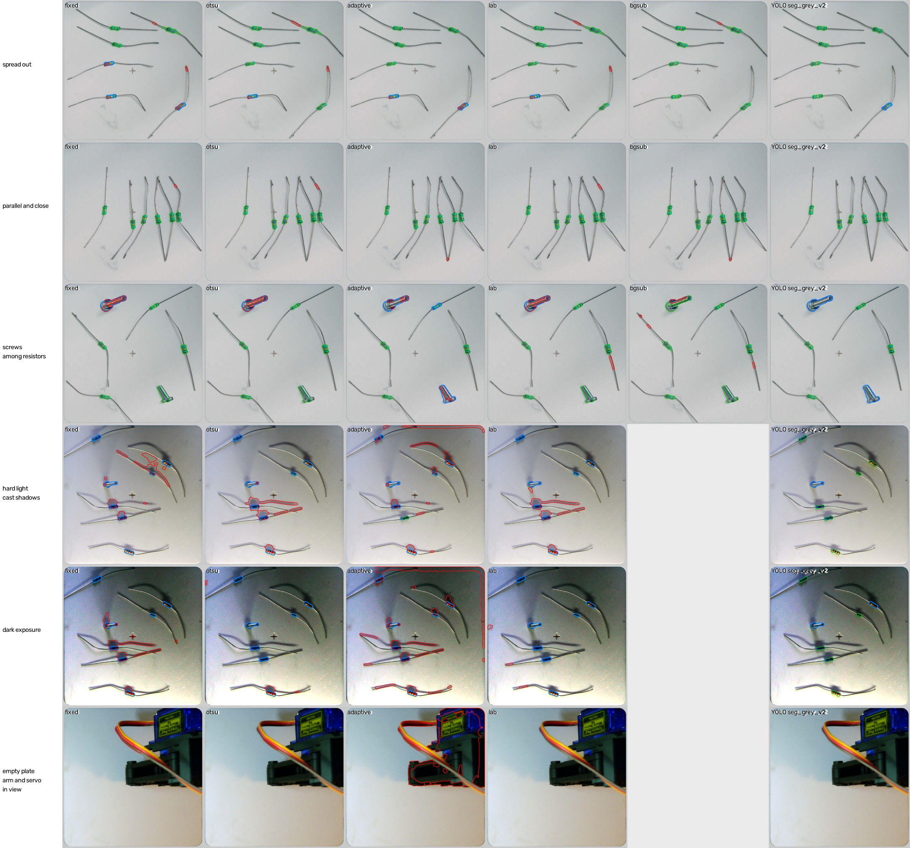

# OpenCV thresholding against YOLO segmentation (2026-11-09)

**Question.** Could classical OpenCV segmentation (thresholds, morphology, contours) find the resistor
bodies instead of a trained network? This record backs up the decision to use a learned model (YOLOv8-seg),
which was made earlier in the project without a written comparison.

**Answer.** No. Even tuned on the test frames themselves, the best thresholding method found 147 of 241
resistor bodies with 147 false detections. YOLO (`seg_grey_v2`, untuned, as used live) found 231 of 241
with 1 false detection.

The project's original classical method, subtraction of an empty-plate frame, comes closest: 139 of 143
bodies on the frames where an empty plate was captured. But it makes 49 false detections there, against
YOLO's 0. It needs an empty-plate frame taken under the same light with the camera unmoved, and it can't
cope with hard shadows or a change of exposure.

Outline colours: **green** is a body found (mask IoU 0.5 or more with its label), **red** a false
detection, **blue** a labelled body that was missed. Background subtraction (`bgsub`) is blank where the
session has no empty-plate frame.

## Method

`compare.py` in this folder; run `python experiments/2026-11-09_opencv_vs_yolo/compare.py`.

**Frames.** The real test frames (`test_sessions` in `configs/dataset.toml`) with every object outlined
(`labelled: "objects"`, rules version 2): 65 frames, holding 241 resistor bodies and 24 screws or bolts.
They cover:

| Condition | Frames | Sessions |
|---|---|---|
| resistors only, room light | 27 | 2026-10-23_a 1 to 9, 2026-10-23_b 1 to 12, 2026-10-29_ref, 2026-11-06_b, 2026-11-06_c |
| screws among resistors | 6 | 2026-10-23_a 10 to 15 |
| hard light, one scene at 12 exposures | 12 | 2026-11-06_a |
| empty plate, robot arm or servo in view | 20 | 2026-11-05_live |

**Same input for every method.** Each method gets what the model gets: the rectified frame,
white-balanced with the plate at grey 200, and masked to the plate (`rectify.model_image`). So no method
has to deal with the bench round the plate.

**The classical methods.** All of them share one post-process:
- an elliptical opening of k px, to cut the thin leads off the bodies
- a 5 px closing
- connected components between 3 and 400 mm²
- each component's outer contour as its outline

They differ only in how they make the first mask:

| Method | First mask | Settings searched |
|---|---|---|
| `fixed` | grey darker than the plate by more than T | T 10 to 70, k 7 to 15 |
| `otsu` | darker than Otsu's threshold over the plate | k 7 to 15 |
| `adaptive` | darker than the local Gaussian mean (block B) by more than C | B 51 to 201, C 5 to 25, k 7 to 15 |
| `lab` | Lab colour distance from the plate's own colour above T | T 10 to 55, k 7 to 15 |
| `bgsub` | Lab distance from the session's empty-plate frame above T: the project's original `autolabel` | T 10 to 55, k 7 to 15 |

**Tuned in OpenCV's favour.** Each method's settings were chosen by grid search for the best F1 on the
test frames themselves: 170 combinations in all. In use they would be tuned on other frames and score
lower, so these figures are an upper bound for OpenCV.

Every method's best kernel came out at the top of the grid (15 px), so larger kernels were checked
afterwards (19 to 31 px). Every method got worse: at 19 px, F1 fell by 0.03 to 0.11, as the opening
began removing small bodies along with the leads. So 15 px is a real best, not an edge of the search.

**YOLO.** `models/seg_grey_v2/best.pt` at conf 0.5, the live default, with no tuning on these frames.
It was trained to segment resistor bodies only and to ignore screws, so it is expected to find no screws.

**Background subtraction** needs an empty-plate frame. Only 2026-10-23_a and _b have one
(`data/backgrounds/`), so it is scored on those 30 frames, and every other method is rescored on the same
30 frames for a fair comparison. Each empty plate is rectified with its session's calibration. In
2026-10-23_a the camera moved up to 26 px during the session, so the empty plate and the frames line up
only as well as the plate fit allows: that is a real weakness of the method on this rig.

**Scoring.** `tools/evaluate.score_frame`: one-to-one matching by mask IoU of 0.5 or more. A prediction
matching no label is a false detection.

## Results

### All 65 frames

| Method | Resistors found (of 241) | Screws found (of 24) | False detections | F1 | Resistor IoU, median | Centre error, 95th pct | Time per frame |
|---|---|---|---|---|---|---|---|
| `fixed` (T 40, k 15) | 133 | 5 | 166 | 0.49 | 0.70 | 1.15 mm | 0.08 s |
| `otsu` (k 15) | 136 | 5 | 155 | 0.50 | 0.72 | 1.04 mm | 0.09 s |
| `adaptive` (B 201, C 25, k 15) | 135 | 1 | 335 | 0.37 | 0.65 | 0.86 mm | 0.28 s |
| `lab` (T 40, k 15) | **147** | 5 | 147 | 0.54 | 0.75 | 0.97 mm | 0.10 s |
| **YOLO `seg_grey_v2`** (conf 0.5) | **231** | 0 (trained to ignore them) | **1** | **0.93** | **0.87** | **0.33 mm** | 0.30 s (GPU) |

### By condition: resistors found / false detections

| Condition | `fixed` | `otsu` | `adaptive` | `lab` | YOLO |
|---|---|---|---|---|---|
| resistors only, room light (27 frames, 151 bodies) | 115 / 57 | 119 / 57 | 116 / 58 | 128 / 55 | **146 / 1** |
| screws among resistors (6 frames, 18 bodies) | 16 / 17 | 17 / 18 | 15 / 32 | 17 / 21 | **18 / 0** |
| hard light, 12 exposures (12 frames, 72 bodies) | 2 / 79 | 0 / 61 | 4 / 149 | 2 / 60 | **67 / 0** |
| empty plate, arm in view (20 frames, no bodies) | 0 / 13 | 0 / 19 | 0 / 96 | 0 / 11 | **0 / 0** |

### The 30 frames with an empty-plate frame (2026-10-23_a and _b)

| Method | Resistors found (of 143) | Screws found (of 12) | False detections | F1 | Resistor IoU, median |
|---|---|---|---|---|---|
| `fixed` | 117 | 5 | 53 | 0.74 | 0.69 |
| `otsu` | 123 | 5 | 63 | 0.74 | 0.70 |
| `adaptive` | 113 | 1 | 64 | 0.69 | 0.64 |
| `lab` | 128 | 5 | 63 | 0.76 | 0.74 |
| `bgsub` (T 30, k 15) | **139** | 7 | 49 | 0.83 | 0.76 |
| **YOLO `seg_grey_v2`** | 138 | 0 | **0** | **0.94** | **0.89** |

## Why thresholding fails here

1. **Leads look like bodies.** Tinned leads are as dark as many bodies, and they join each body at both
   ends. An opening wide enough to cut them off (15 px, 1.5 mm) also eats the body ends and small
   bodies, and it still leaves lead stubs and bends as false detections (red in the figure). The figure's
   "spread out" row shows this even in the easiest frames.
2. **Shadows look like bodies.** Under hard light every method outlines the cast shadows of the leads
   and bodies, and merges each body with its shadow. They found 0 to 4 of 72 bodies, against YOLO's 67.
   One fixed threshold cannot separate a dark shadow from a dark body.
3. **Exposure moves the threshold.** The same scene at 12 exposures needs a different threshold at each.
   White balance brings the plate to 200, but not the contrast of the bodies against it.
4. **Light bodies barely differ from the plate.** A beige body is close to the plate's grey. A threshold
   loose enough to find it also finds every smudge and pencil mark.
5. **Anything dark is a body.** With no notion of shape, the robot arm and servo over the plate break
   into dozens of "bodies" (up to 96 false detections over 20 empty-plate frames). A screw is found as
   readily as a resistor, so thresholding can't tell them apart either.
6. **Background subtraction moves the problem.** Subtracting an empty plate removes the plate's own marks
   and comes closest. But it needs an empty frame per session, under unchanged light, with the camera
   still. It still finds shadows, leads and lead stubs (49 false detections on 30 frames), and it can't
   run live once the light or camera changes.

The learned model avoids all six because it has learned what a body looks like, not just how dark it is.
That is what lets it ignore leads, shadows and the arm, hold up from dark to bright exposures, and give
outlines tight enough for picking (centre error 0.33 mm at the 95th percentile, against about 1 mm).

## Limits

- **Classical settings tuned on the test frames.** This favours OpenCV, so the gap in use would be wider.
- **One shared post-process.** Better lead removal (skeleton pruning, shape filters on elongation, a
  watershed for touching bodies) could raise the classical scores. It would add more tuned settings, and
  it would not help with shadows, exposure or the arm.
- **The labels in 2026-10-23_a and _b** are an earlier model's (`synth_only_v1`) own outlines, which
  slightly favours YOLO's outline IoU there. It doesn't affect found/missed counts much, since
  matching needs only 0.5 IoU.
- **Screws.** YOLO `seg_grey_v2` was trained to ignore them, so its 0 of 24 is by design. The next model
  (`experiments/2026-11-09_object_seg_design`) learns to find them.

## Files

- `compare.py`: the comparison. `--figure-only` redraws the figure from the best settings in
  `results.json`.
- `results.json`: every figure above, per method and condition, and each method's best settings.
- `figure_methods.jpg`: six kinds of frame, each method's outlines.
