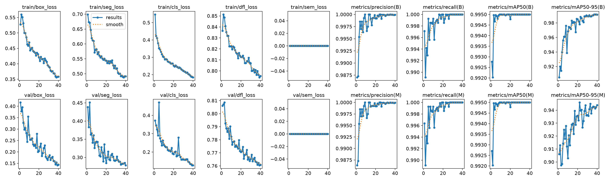
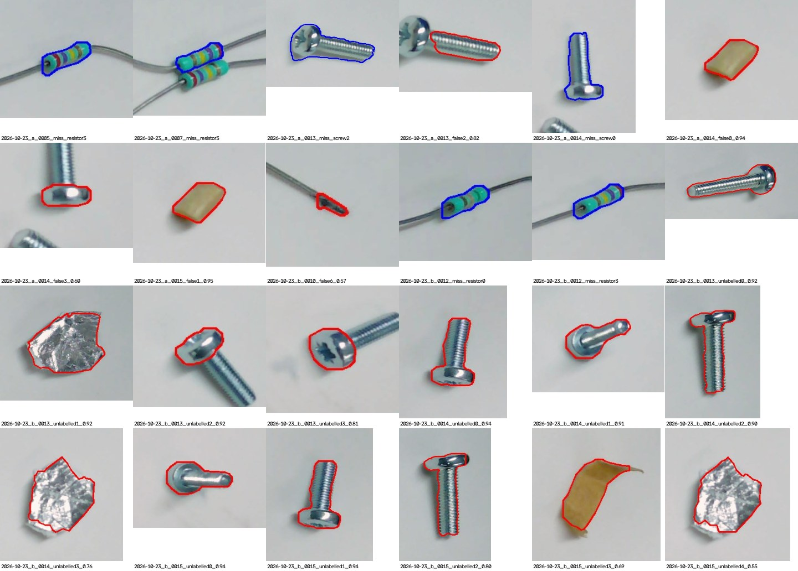
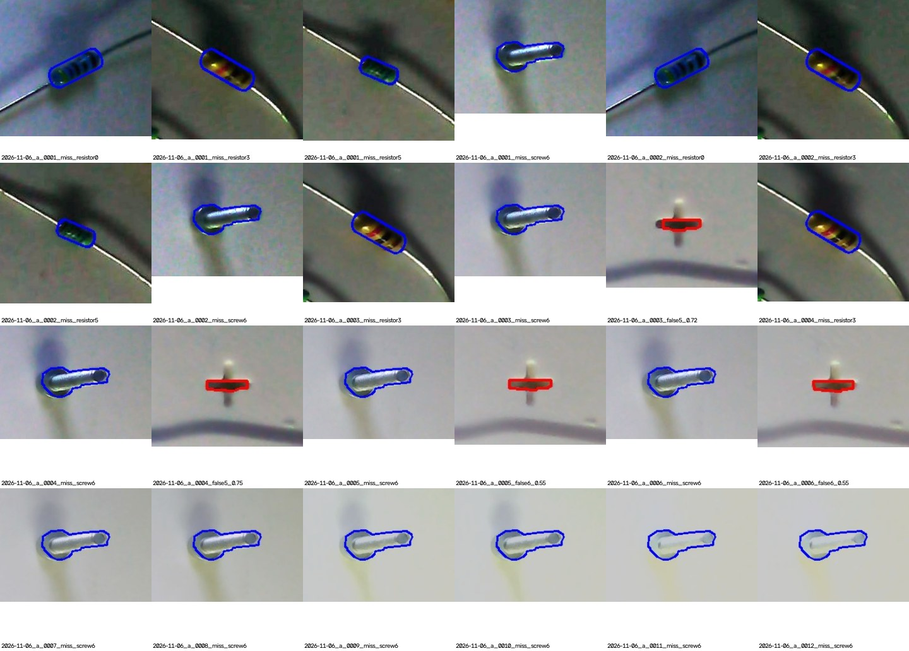
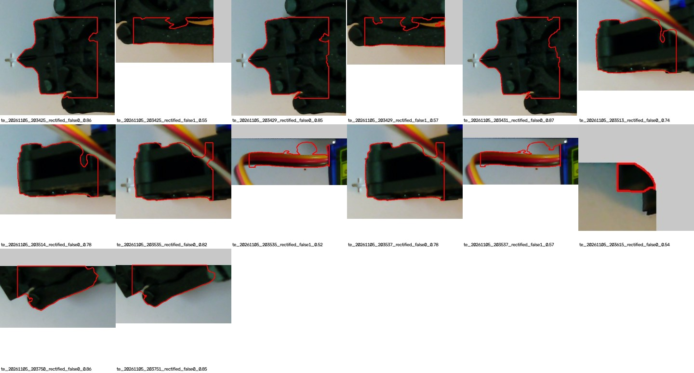
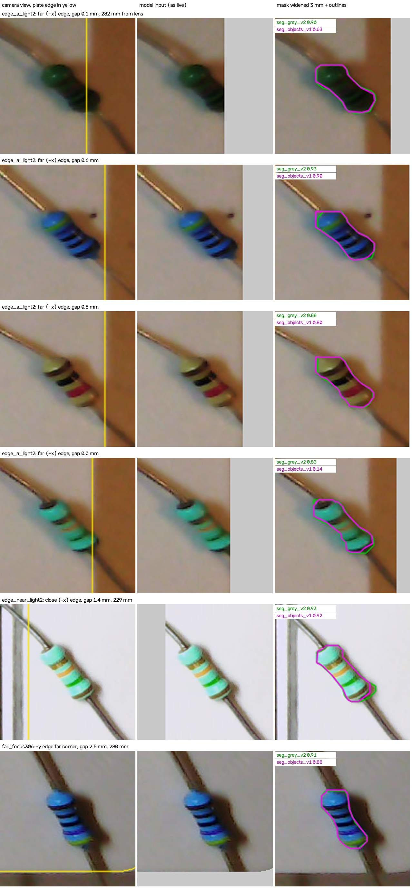
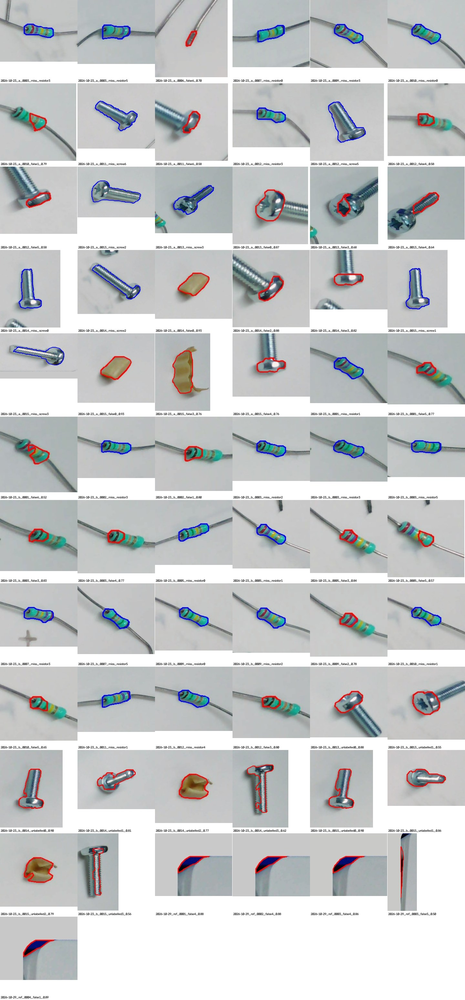
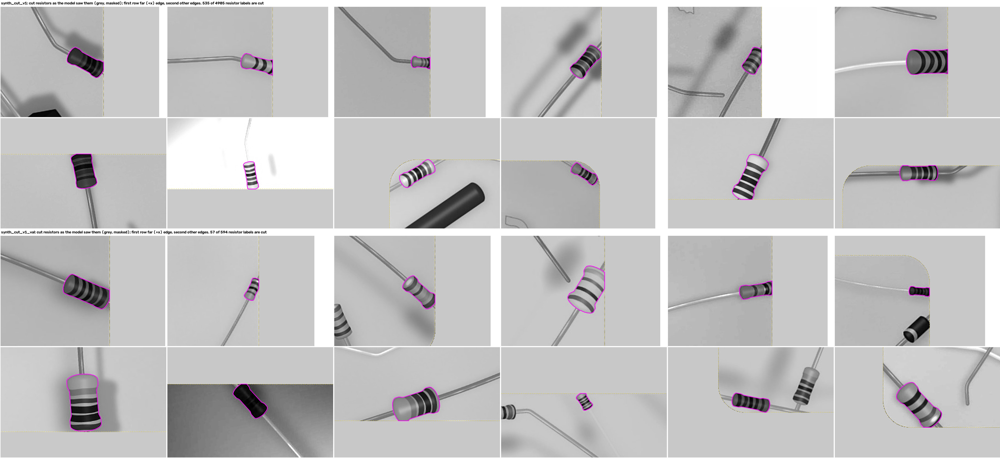
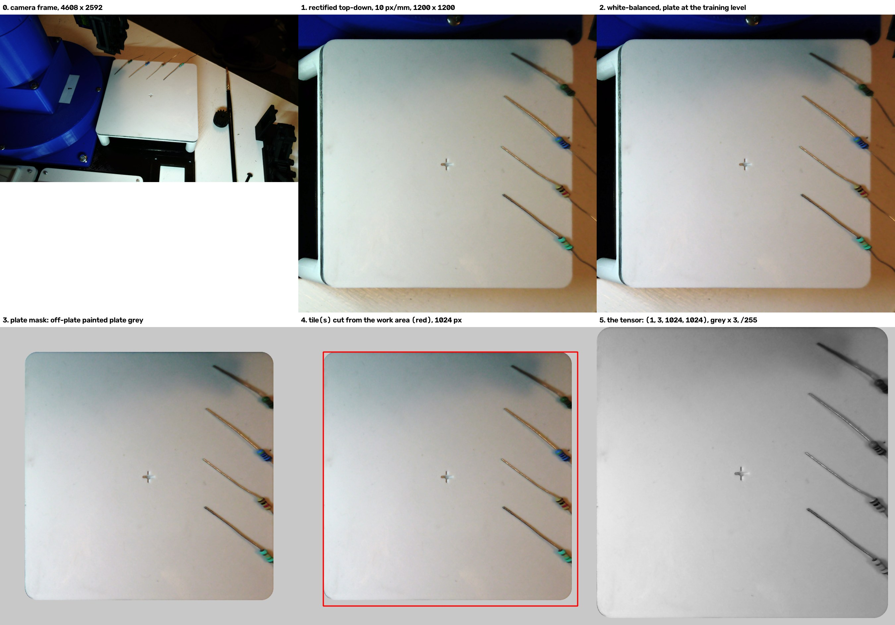

# Testing `seg_objects_v1` against `seg_grey_v2` (2026-11-09)

**Question.** Does the first model trained to find every pickable object (`seg_objects_v1`, designed in
`experiments/2026-11-09_object_seg_design`) find resistors at least as well as the current model
(`seg_grey_v2`), and does it find the other objects?

**Answer so far (offline tests only).**
- **Resistors:** about as well. It found 229 of 241 bodies against 231, and the misses are different
  ones.
- **Screws:** it now finds them, 10 of 24. It finds every screw in room light except two that it
  outlines only in part, but none under hard light.
- **False detections:** 23 against 1, on the 65 frames with every object outlined. 14 are the robot arm,
  servo and cable crossing an empty plate. 4 are the plate's crosshair groove under hard light. The rest
  are a wood chip, part-outlined screws and a lead offcut.

So it does **not yet pass** test 1 of the design record ("at least as good as `seg_grey_v2`"). Every false
detection has an identified cause, and each has a fix proposed below.

**Live on the rig** (below), both models lose bodies lying at the plate's **far edge**. The camera's
angle makes a body's top appear past that edge, and the plate mask cuts it off. Focus was ruled out.
The fix is to keep the mask and teach cut-off bodies: `seg_objects_v2`, below.

## Training

| | |
|---|---|
| Data | `synth_obj_v1`: 1,200 synthetic tiles, 10,993 objects. Validation `synth_obj_v1_val`: 150 tiles, 1,377 objects. Objects profile, `[synthetic_objects]` in `configs/dataset.toml` |
| Model | YOLOv8m-seg from COCO `yolov8m-seg.pt`, greyscale input, one class `object`, rules version 2 |
| Run | 40 epochs, batch 4, 1024 px, 3 h 05 min on the RTX 3060 laptop GPU (`runs/seg_objects_v1`) |
| Weights kept | epoch 40, the best by ultralytics' fitness (box and mask together): mask mAP50-95 0.944, mAP50 0.995 on the synthetic validation set. Mask mAP50-95 alone peaked at 0.946 at epoch 22 |

The command was:

```
python -m robot_offline.training.train_synth --train synth_obj_v1 --val synth_obj_v1_val --name seg_objects_v1 --grey --epochs 40 --patience 12
```



The synthetic validation score isn't comparable with `seg_grey_v2`'s 0.888, which was measured on a
different set. It took 3 hours, against about an hour for `seg_grey_v2`, because some epochs ran 2 to 3
times slower: the GPU's 6 GB was nearly full while desktop apps were open. The weights are in
`models/seg_objects_v1/`.

## Test 1: the real test frames

`compare_models.py` in this folder writes `results.json`. `errors.py [model]` draws every miss and false
detection. The frames are the same 68 as in the OpenCV comparison (`test_sessions`): 241 resistor bodies
and 24 screws or bolts, never trained on. Both models are run at conf 0.5, the live default, with
greyscale input.

| | `seg_grey_v2` | `seg_objects_v1` |
|---|---|---|
| Resistors found, of 241 | **231** | 229 |
| beige / blue / green / green small / small / turquoise | 26/30, 51/51, 2/2, 11/12, 3/3, 138/143 | 26/30, 49/51, 2/2, 10/12, 3/3, 139/143 |
| Screws and bolt found, of 24 | 0 (trained to ignore them) | **10** |
| False detections, on the 65 frames with every object outlined | **1** | 23 |
| Resistor outline IoU, median | 0.87 | 0.86 |
| Resistor centre error, median / 95th percentile | 0.15 / **0.33 mm** | 0.17 / 0.47 mm |
| Resistor yaw error, median / 95th percentile | 1.0° / 7.6° | 1.1° / **6.2°** |
| Resistor length / width bias | −0.12 / −0.04 mm | −0.23 / −0.07 mm |
| Screw outline IoU, median | none found | 0.82 |

The centre target in `docs/plan.md` is 1 mm, so both models meet it. The new model's resistor outlines
are about 0.1 mm shorter, and its 95th-percentile centre error is 0.14 mm larger.

### Where it goes wrong



Room light (2026-10-23 to 2026-11-06 sessions). Blue is a miss, red a false detection. "unlabelled"
marks a frame from 2026-10-23_b 13 to 15, which have only their resistors outlined because of the foil.
There, the model finds every screw, the foil and a wood shaving; that is right under the new rules, so
these frames are left out of the false-detection counts.



Hard light: one scene at 12 exposures (2026-11-06_a).



Empty plate with the robot arm in view (2026-11-05_live).

The 23 false detections, by cause:

| Cause | Count | Where | Proposed fix |
|---|---|---|---|
| Robot arm, servo and servo cable over the plate | 14 | 10 of the 20 empty-plate frames; 13 of them are 25.8 to 30 mm long, the last is an arm corner at the plate edge | Synthetic: add large dark shapes (arm-like, crossing the plate edge) drawn unlabelled. Live: detect with the arm parked off the plate, which is the normal case. A size cap of 25 mm would remove 13 of the 14, but the longest real object found is a screw at 24.1 mm, so the margin is too thin to rely on |
| The plate's crosshair groove (1 mm × 5 mm) under hard light | 4 | 2026-11-06_a frames 3 to 6 | Synthetic: draw the groove; it is missing from `synth.py`. Or mask detections at its known position (`crosshair_mm` in `configs/dataset.toml`) |
| Wood chip, 8 × 5 mm | 2 | 2026-10-23_a 14 and 15 | A rules question. The real labels call it background (rule 8, offcuts), but synthetic "blocks" look the same. Decide whether a chip is an object, then fix one or the other |
| Screw outlined only in part: shaft without head, head alone | 2 | 2026-10-23_a 13 and 14 | Each also counts as a missed screw. More screws lying at angles in the synthetic set |
| Clipped lead end, 4 × 2 mm | 1 | 2026-10-23_b 10 | Offcuts are background (decided). Draw clipped lead ends as unlabelled distractors in synth |

The misses:
- **Hard light:**
  - the **bolt is missed in all 12 exposures**: it lies in its own hard shadow
  - the blue and small green bodies lying in the deep shadow of the large object are lost in the two
    darkest frames
  - the beige misses are the same four as `seg_grey_v2`'s
- **Room light:** four turquoise bodies:
  - two bodies with a sharp lead bend at the body (2026-10-23_b 12)
  - one bent lead (2026-10-23_a 5)
  - one of a touching pair (2026-10-23_a 7)

  `seg_grey_v2` misses four or five different turquoise bodies, so this is a wash.

## Live test on the rig: the plate's far edge (2026-11-09, evening)

`live_compare.py` runs both models on the same 15 live frames per placement, a few frames apart. It
uses conf 0.05 (`steady.FLOOR`, what `live_detect` keeps), with plate search and exposure at the
band-reading level, as in `2026-11-09_front_back`. A body counts as found in a run at 0.5 or more.

Everything is in `live/`. Per placement:
- `<tag>.json`: scores in every run, outline size, jitter, and the gap to the edge
- `<tag>_overlay.jpg`: both models side by side
- `<tag>_model.png`: the model's input
- the raw camera frames (`*_raw.png`, LFS; three per placement from `edge_near_light2` on)
- the plate fit

**Terms used below:**
- **Far edge:** the plate's +x edge, on the **right of the top-down image**, furthest from the lens.
  The camera stands off the −x edge, on the left.
- **Light 1:** the room light the session started in: exposure −4, gain 8, hard shadows thrown
  outward.
- **Light 2:** softer and brighter: exposure −5, gain 24.

| Placement | Light | Bodies, gap to the edge | `seg_grey_v2` runs found | `seg_objects_v1` runs found |
|---|---|---|---|---|
| `as_found_a`: the plate as left, one body near the far edge | 1 | 6.2, 15.8, 23.4, 27.1 mm | 15, 15, 15, 15 | **14** (median 0.62), 15, 15, 15 |
| `edge_a`: four diagonal against the far edge, leads off | 1 | 0.1, 1.1, 0.9, 0.0 mm | 4, 1, 2, 1 | 0, 1, 0, 0 |
| `edge_a_light2`: the same, unmoved | 2 | 0.1, 0.6, 0.8, 0.0 mm | 7, 15, 15, 0 | 0, 15, 15, 0 |
| `edge_near_light2`: four diagonal against the close (−x) edge | 2 | 4.2, 2.6, 3.5, 1.4 mm | 15, 15, 15, 15 | 15, 15, 15, 15 |
| `far_focus290` to `far_focus314`: four along the −y edge (bottom of the image), 233 to 280 mm from the lens, at focus 290, 298, 306, 314 | 2 | 0.9 to 2.5 mm | 14 or 15 each, at every focus | 14 or 15 each, at every focus |
| `final_a`: three lying along the far edge, one inside | 1 | 1.9, 0.0, 1.6, 14.9 mm | 15, **2**, 15, 15 | 15, **14** (0.71), 15, 15 |

### Why bodies at the far edge are lost: parallax and the plate mask, not focus

The top-down image is true only at the plate's surface. Anything standing on it appears pushed away
from the lens. By today's plate fit, the top of a 2.5 mm body moves:
- 2.4 mm outward at the far edge
- 0.35 to 0.8 mm along the side edges
- 1.3 mm *inward* at the close edge

So a body lying at the far edge appears to overhang it. `rectify.mask_outside_plate` paints everything
past the edge plate grey, which cuts the body's outer end off. The model is given half a resistor
with a straight cut down one side.



`edge_evidence.py` draws this from the saved frames:
- **Rows 1 to 4: the far-edge bodies of `edge_a_light2`.** In the camera's view the outer end crosses
  the plate edge (yellow), and in the model's input it is cut away. With the mask widened 3 mm, both
  models find them again: the dark green one goes from lost to 0.90 and 0.63.
- **Row 5: the close edge,** where nothing is cut.
- **Row 6: a body on the −y edge,** at the same distance from the lens as rows 1 to 4 (280 mm) but
  barely cut. Both models find it.

**Focus was ruled out.** It was the user's first thought, and a fair one, since the far side is softer:
- **At the −y edge, focus made no difference.** The four bodies there were found in every run at focus
  290, 298, 306 and 314, including the one 280 mm from the lens.
- **Band reading (robot-offline-01) measured band sharpness on the same frames.**
  - The 281 mm body is sharpest at focus 290 or below, and at 306 has about 70% of that sharpness, so
    a close-up there gains about 1.4×.
  - The close edge is further from its best focus at 306 (about 50 to 70% of best), yet it was found
    15/15.
- **So 306 is soft at the far edge for band reading, not for segmentation.** Band reading refocuses
  for each resistor for that reason. Segmentation finds bodies the same at every focus; only the cut
  bodies are lost.

**The light decides the marginal cases.** Bodies 0.6 to 0.8 mm in were lost in light 1, whose hard
shadows fall outward over the edge, and found in light 2. Bodies at 0 to 0.1 mm were lost in both.

### Two fixes, and why the mask stays as it is

**A. Widen the mask where parallax pushes outward.** `rectify.plate_mask(settings, lift_mm)` also keeps
whatever the plate would cover if it were lifted towards the camera by up to `lift_mm`. For a 3 mm
lift that adds:
- about 3 mm at the far edge
- 1 mm and 0.5 mm at the two sides
- nothing at the close edge

The default is 0, so nothing changes unless asked. `mask_lift.py` tried a 3 mm lift (results in
`mask_lift.json`):

| Real test frames, conf 0.5 | Resistors found | False detections (65 complete frames) |
|---|---|---|
| `seg_grey_v2`, mask as now / lifted 3 mm | 231 / 231 | 1 / 1 |
| `seg_objects_v1`, mask as now / lifted 3 mm | 229 / 227 | 23 / **59** |

On tonight's captures the lift brought back one cut body for each model. But the strip it reveals is
often a dark band: the gap and shadow between the plate and the rig, or the blue frame. 
`seg_objects_v1` was taught that any dark object of pickable size is an object, so it outlines the
band: 34 of its new false detections lie mostly off the plate.

**B. Keep the mask, and teach the model cut bodies.** Chosen by the user on 2026-11-09.

> **Lesson: take an unknown background out before teaching.** What lies past the plate is not under
> our control: wood at home, a dark gap and a blue frame in the lab, the arm. Every pixel of it the
> model sees is variability it must learn to ignore, and the synthetic set can't reproduce it
> faithfully. Masking it to plain plate grey removes that variability. The one new thing to learn, a
> body cut off at the edge, is then learned against a fixed, known surround. This is also why the
> model is given the plate alone at all (`rectify.model_input`). Fix A would undo that at exactly the
> edge where it matters.

## Next model: `seg_objects_v2` (cut-off bodies)

**The new synthetic profile.** `synth --profile objects_cut` (`[synthetic_objects_cut]` in
`configs/dataset.toml`) builds on `[synthetic_objects]`:
- 35% of bodies are placed against an edge, up from 25%.
- 60% of those are placed by where they **lie** (footprint 0 to 1.5 mm from the edge), not by how they
  appear.
- At the far edge their tops then overhang, and the plate mask cuts them, as on the rig. Their label
  is what the mask leaves.

The tests are in `tests/training/test_synth.py`, under "Cut-off bodies". Without the profile, nothing
changes.

**Fine-tuned from `seg_objects_v1`, not trained from scratch.** `seg_objects_v1`'s validation score
levelled off by about epoch 17 of 40 (0.939 to 0.946 from there on), so 40 epochs on 1,200 frames was
more than it needed. This run uses:
- 800 training frames (`synth_cut_v1`, seed 2) and 100 validation frames (`synth_cut_v1_val`, seed 3)
- at most 15 epochs, stopping after 5 without improvement

```
python -m robot_offline.training.synth --profile objects_cut --name synth_cut_v1 --frames 800 --seed 2
python -m robot_offline.training.synth --profile objects_cut --name synth_cut_v1_val --frames 100 --seed 3
python experiments/2026-11-09_object_seg_design/label_real_objects.py --write   # a synth run drops the real labels
python -m robot_offline.training.train_synth --train synth_cut_v1 --val synth_cut_v1_val --name seg_objects_v2 --grey --epochs 15 --patience 5 --weights models/seg_objects_v1/best.pt
```

**Left out of this round,** so that its effect stays readable: the crosshair groove, arm-sized dark
shapes and clipped lead ends. Those are the other causes of false detections above.

### Result: worse, not adopted

Training stopped early after epoch 10; the best epoch was 5 (synthetic validation mask mAP50-95
0.942). The weights are kept in `models/seg_objects_v2/` as a record only.

| Real test frames, conf 0.5 | `seg_grey_v2` | `seg_objects_v1` | `seg_objects_v2` |
|---|---|---|---|
| Resistors found, of 241 | 231 | 229 | **211** |
| Screws found, of 24 | 0 | 10 | 7 |
| False detections (65 complete frames) | 1 | 23 | **53** |

On tonight's live captures (`v2_check.json`, by `mask_lift.py --models ... --lifts 0`):
- **`final_a`:** it kept the overhanging beige body in 3 of 3 frames, but lost a body 15 mm inside
  the plate.
- **`edge_a`:** it still found 0 of 4.



**What went wrong.** It learned that a body may end anywhere. It outlines whole real resistors only
in part, up to a band edge or one end, and each of those counts as a miss and a false detection. It
splits screws into head and shaft, and it takes dark slivers where the mask meets the rig for cut
objects.

`cut_samples.py` (`cut_samples.jpg`) shows the cut bodies it trained on, as it saw them:



- **There were more of them than intended:** 535 of 4,905 resistor labels (11%).
- **The cut is often hard to see.** The off-plate fill is plate grey, so the cut shows only where the
  plate's own shading differs from the fill. In greyscale it looks much like a band edge.
- **Augmentation scrambles position:** rotations up to 180° and flips put the far edge on every side.

So nothing in the input said "this body is cut because it meets the edge". The only rule the labels
taught was "outlines may stop part way".

`inference_input.py` (`inference_input.jpg`, `inference_tensor.png`) shows what the network is given
at inference, step by step, down to the tensor captured from ultralytics' own preprocessing:



- **The tensor:** one 1024 px tile covering the plate, greyscale copied into three channels, 1 × 3 ×
  1024 × 1024 float32 in 0 to 1.
- **The plate edge here:** in this real frame it shows as a tone step, because the fill is lighter
  than the shaded far side. That is inconsistent from frame to frame.
- **Where the tile sits:** it starts at the plate's top-left corner. So the close and top edges lie on
  the tensor's border, and the far and bottom edges have 24 px of fill beyond them.

### Teaching cut bodies only at the edge: parked

**Decided by the user on 2026-11-10:** worth doing only if far-edge bodies ever matter enough. The
gain is bodies within about 1.5 mm of one edge. Cheaper ways to cover it:
- a low lip (about 3 mm) along the far edge
- a 3 mm no-go strip there in the robot's logic
- for `seg_grey_v2`, the lifted mask, which cost nothing on the test frames

**The recipe, if it's picked up:**
1. **Fill everything off the plate with a fixed, distinct value** (black or a flat dark grey) instead
   of plate grey, in synth, export, live and evaluation. Record the fill in `handoff.json`, as the
   grey input is recorded. A cut then always shows as "body meets the fill", which only happens at
   the plate edge, so the cue is local and rotation augmentation can stay.
2. **Make cut bodies a few percent of a mixed set** (with `synth_obj_v1`), not 11%.
3. **Use a low learning rate** if fine-tuning, so what the model knows about whole bodies survives.
4. **Judge it on real frames:** tonight's far-edge captures and the real test frames. Synthetic
   validation said 0.942 here while real performance dropped.

**Best weights as of 2026-11-10:**
- **Resistors only:** `seg_grey_v2`, the live default.
- **Every pickable object, with resistor or not:** `seg_objects_v1` plus `resistor_tag_v1`
  (`experiments/2026-11-09_resistor_tag`), with the arm parked off the plate during detection.

## Still to run (rig)

| # | Test (design record) | Status |
|---|---|---|
| 2 | Bodies near the plate edge | Far edge: see above. The side and close edges pass. To repeat with `seg_objects_v2` |
| 3 | Front, middle and back | not yet |
| 4 | A new real session of non-resistor objects, outlined by hand | not yet |
| 5 | Outline stability, live | partly: centre jitter is in every `live/<tag>.json` |
| 6 | Resistor tag | the classifier isn't built |

## A bug found on the way

`tiling.wants_grey` looked for `handoff.json` only beside the weights file. `train.py` writes it to the
run folder (`runs/<name>/handoff.json`), but the weights sit in `runs/<name>/weights/`. So a model
evaluated straight from its run was fed **colour** frames, silently. That first evaluation gave 209 of
241 resistors and 17 of 24 screws. It now looks in the run folder too
(`tests/inf/test_tiling.py::test_weights_in_a_training_run_use_the_run_folders_handoff`). Models in
`models/<name>/`, including the live ones, were never affected.

## Files

- `compare_models.py`: both models on the real test frames; writes `results.json`, including every
  false detection's size and score.
- `errors.py`: crops of every miss and false detection in `errors_<model>/`, and the
  `sheet_<model>_<condition>.jpg` sheets. `seg_grey_v2`'s are here too, for comparison.
- `training_curves.png`: ultralytics' losses and validation metrics over the 40 epochs.
- `live_compare.py`: the live test, both models on the same frames. `--focus` overrides the focus
  for one capture; `--replay` runs on a saved frame. Its results are in `live/`.
- `edge_evidence.py` and `edge_evidence.jpg`: the cut-off bodies, in the figure above.
- `mask_lift.py` and `mask_lift.json`: fix A, tried on tonight's captures and the real test frames.
